# sandboxd — Architecture & Field Guide

> A complete walkthrough of what sandboxd is, how it is put together, why each
> piece exists, and how it actually behaves against a real `nsjail` kernel
> sandbox. Diagrams are [Mermaid](https://mermaid.js.org/); they render on
> GitHub/GitLab and in most Markdown viewers.

- Version: **0.0.5** (pre-alpha)
- Language: Go 1.23+
- Isolation: [`nsjail`](https://github.com/google/nsjail) (Linux namespaces,
  cgroups v2, seccomp, rlimits)
- Transport: HTTP/JSON, base path `/v1`
- Storage: local filesystem JSON (no database)

---

## 1. What is sandboxd, and what is it useful for?

sandboxd is a **secure, multi-tenant code-execution backend exposed over
HTTP/JSON**. A client (a web IDE, a CI runner, an AI agent, a grading system, a
notebook frontend… anything that can make HTTP calls) authenticates with an API
key, creates a *workspace*, uploads files into it, and runs code inside that
workspace. The code runs in a locked-down `nsjail` sandbox with CPU, memory,
disk, and process limits, and with **no network by default**.

### The problem it solves

Running untrusted code is dangerous. A naive "run this Python" endpoint lets a
tenant:

- read the host's files (`/etc/shadow`, other tenants' data),
- reach the network and exfiltrate secrets or scan internal hosts,
- fork-bomb the machine, exhaust RAM, or fill the disk,
- leave orphan processes running forever,
- escape via path traversal or symlinks in the file API.

sandboxd defends against all of these with **defense in depth**: authentication +
ownership checks at the API layer, path-safety at the filesystem layer, and
kernel-enforced isolation at the execution layer.

### Typical use cases

| Use case | How sandboxd fits |
|----------|-------------------|
| Online code playground / IDE | Create workspace, upload `main.py`, `exec` to get output |
| Autograder / coding tests | Async `run` per submission, poll logs, stop on timeout |
| AI agent tool-use ("run this code") | Sync `exec` with hard 60 s cap and capped output |
| Data-transform jobs | Upload inputs, `run` a script, download results from the workspace |
| Plugin/extension sandbox | Confine third-party code with no network + resource caps |

### What it deliberately is *not* (v0.0.5)

Pre-alpha scope. It is a single-node, static-key service. Not yet: a hardened
public-internet multi-tenant platform, a distributed scheduler, or a
GPGPU/long-running job engine. See [§12 Known limitations](#12-known-limitations).

---

## 2. The 10,000-foot view

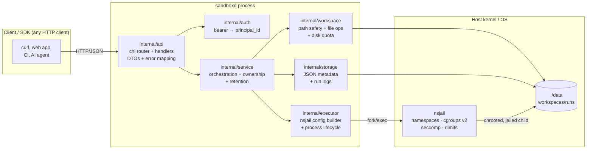

The flow is strictly layered:

- **api** knows HTTP, not the filesystem.
- **service** knows policy (ownership, limits, retention), not HTTP or nsjail
  internals.
- **workspace / storage / executor** are the three "hands": safe file I/O, JSON
  persistence, and process execution.

This separation is what lets the entire service be tested without `nsjail` (the
executor is an interface with a `FakeRunner`) and without a real HTTP socket
(`httptest`).

---

## 3. Package-by-package map

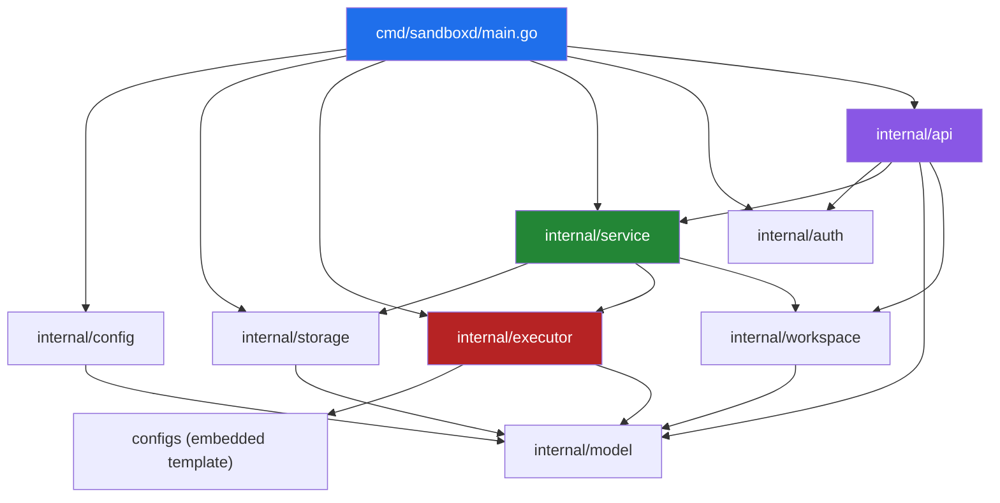

| Package | File(s) | Responsibility |
|---------|---------|----------------|
| `cmd/sandboxd` | `main.go` | Wire config → storage → executor → service → auth → HTTP server; graceful shutdown |
| `internal/config` | `config.go` | koanf YAML loader, defaults, byte-unit helpers |
| `internal/model` | `types.go`, `errors.go` | Domain types (Workspace, Run, Limits), ULID IDs, API error type |
| `internal/auth` | `auth.go` | Static bearer keys → `principal_id`, constant-time compare |
| `internal/api` | `router.go`, `*.go` | chi routes, handlers, DTOs, JSON error envelope, Prometheus metrics, audit log |
| `internal/service` | `service.go`, `files.go`, `exec.go`, `runs.go` | Orchestration, ownership checks, limits, retention, run registry |
| `internal/workspace` | `fs.go`, `path.go` | Safe rooted filesystem, traversal/symlink defense, disk quota accounting |
| `internal/storage` | `store.go` | Atomic JSON metadata + run-log files on disk |
| `internal/executor` | `executor.go`, `nsjail.go`, `identity.go`, `fake.go` | nsjail config rendering, UID/GID mapping, process lifecycle, capped capture |
| `configs` | `nsjail_python.cfg.tmpl`, `embed.go` | nsjail TextProto template (also compiled into the binary) |
| `scripts` | `acceptance.sh`, `nsjail-stub.py` | End-to-end acceptance transcript; test stub |

Total ≈ 6.4k lines of Go across 8 packages, plus one embedded template and an
OpenAPI 3.1 spec (`api/openapi.yaml`).

---

## 4. Request lifecycle (end to end)

### 4.1 The middleware + routing chain

Every request flows through a fixed chain before it reaches a handler:

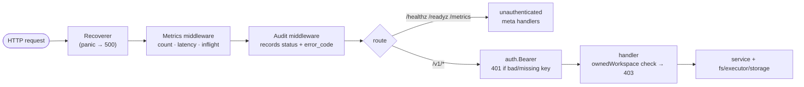

Key subtlety: the **audit middleware** wants the `principal_id`, but context
values only flow *inward*, and `auth.Bearer` runs *after* audit. sandboxd solves
this with a `*string` **principal sink** placed in the context before routing;
the bearer middleware writes into it, and the audit middleware reads it after
the response. See `internal/auth/auth.go` and `internal/api/middleware.go`.

### 4.2 Synchronous `exec`

`POST /v1/workspaces/{id}/exec` runs one command and returns its output inline.
Hard cap: 60 s.

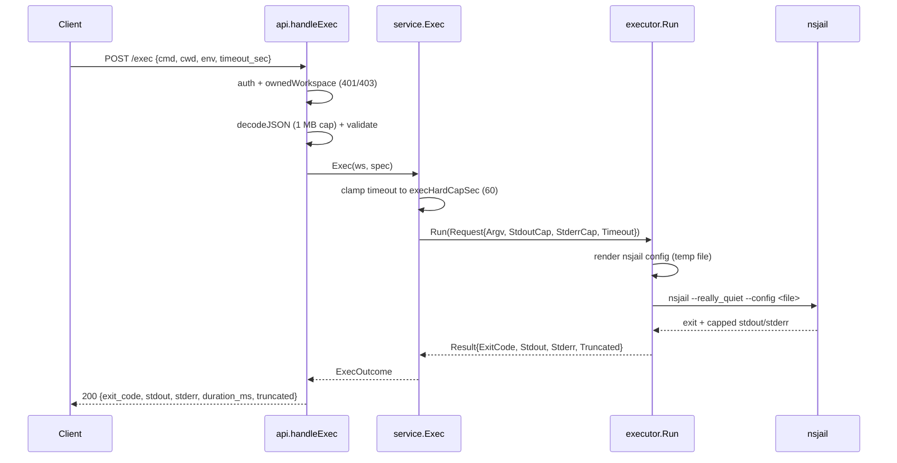

### 4.3 Asynchronous `run`

`POST /v1/workspaces/{id}/runs` returns `202` immediately; the run continues in
a goroutine, its stdout/stderr are streamed to log files, and the client polls
`/runs/{runId}` and `/runs/{runId}/logs`.

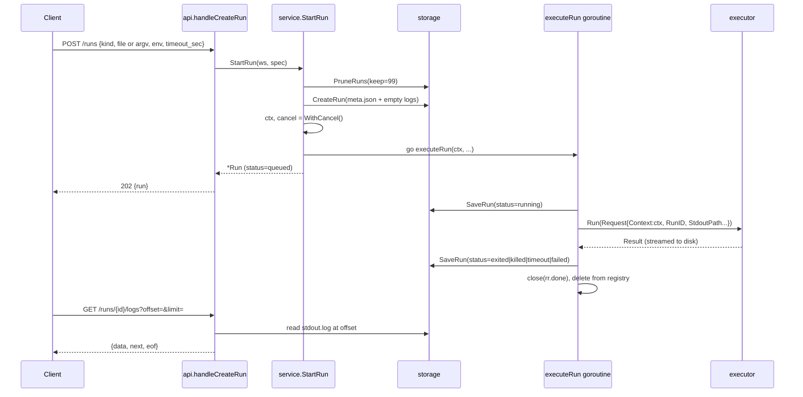

### 4.4 Run state machine

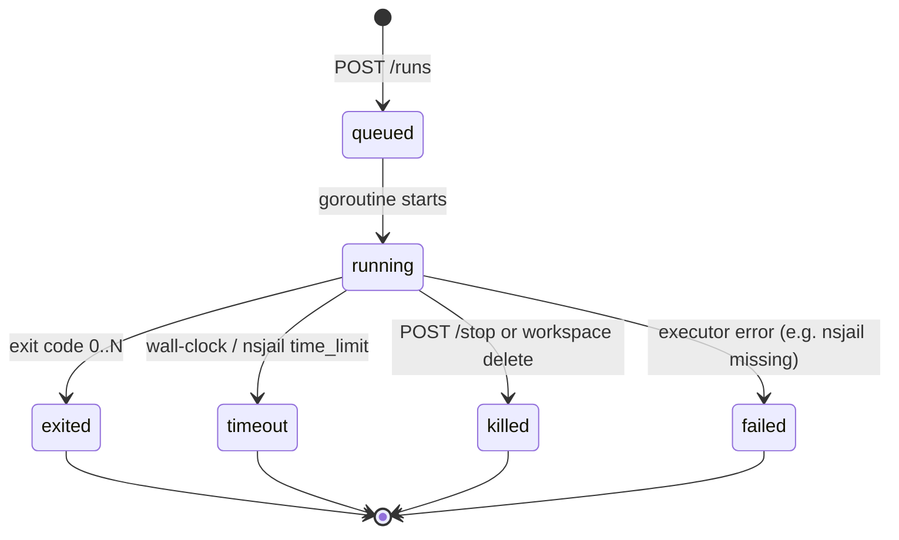

`stop` is **idempotent**: stopping an unknown or finished run returns the
current status and signals `false`. A stop both cancels the context and calls
`runner.Kill`, which kills the whole process group.

---

## 5. The isolation model (the heart of the project)

This is the part that actually makes sandboxd safe, and the part with the most
subtle real-world behavior.

### 5.1 What nsjail enforces, per run

Each run gets a fresh nsjail instance described by a config file rendered on the
fly (`configs/nsjail_python.cfg.tmpl`). The rendered sandbox has:

| Layer | Setting | Effect |
|-------|---------|--------|
| Namespaces | `clone_newpid/ns/ipc/uts/user` always; `newnet` unless `allow_net` | Isolated PID, mount, IPC, UTS, user; no network |
| mount ns | host `/usr`,`/lib`,`/lib64`,`/bin`,`/sbin` RO; workspace RW at `/workspace`; private `/tmp` | Child sees only the runtime + its own files |
| `/proc` | `mount_proc: false` | Host process table not visible |
| cgroup v2 | `cgroup_mem_max`, `cgroup_pids_max`, `cgroup_cpu_ms_per_sec` | Memory, process-count, CPU throttling |
| rlimits | `as`, `fsize`, `nofile`, `nproc`, `core=0` | Kernel-enforced ceilings |
| seccomp | default-allow, KILL a dangerous denylist | `mount`, `ptrace`, `bpf`, `kexec_*`, `reboot`, `setns`, `unshare`, modules, keyctl, … |
| identity | uid/gid map + `--user sandbox` | Runs as the unprivileged `sandbox` user |
| time | `time_limit` | Wall-clock kill |

### 5.2 The filesystem the sandbox sees

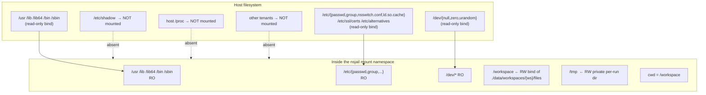

Consequences proven by the acceptance transcript: a jailed process cannot read
`/etc/shadow` (`FileNotFoundError` — it simply isn't mounted), cannot open a
network socket (`OSError`), and dies with `SIGSYS` if it calls `mount(2)` or
`ptrace`.

### 5.3 UID/GID mapping — the trickiest part

Linux only lets an unprivileged process write a **single-entry** uid/gid map
whose *outside* id equals its own effective id. sandboxd maps the sandbox
identity *inside* the namespace onto an id that is permitted *outside*,
depending on how the orchestrator is running:


This dual behavior is why the service works both as root and as a normal user
(with the caveat in §10 about unprivileged user namespaces being disabled by
some kernels/AppArmor).

### 5.4 Why real nsjail is finicky (discovered during E2E)

The nsjail TextProto schema is **strict** — an unknown field is a hard parse
error. Getting to a green real-nsjail run required:

- Remove invalid fields `chroot`, `chroot_base`, `disable_proc`, `proc_path`;
  use `mount_proc: false`.
- `use_cgroupv2: true` is required for the unified cgroup hierarchy on modern
  hosts; `cgroup_mem_max` is in **bytes**.
- `uidmap`/`gidmap` `inside_id`/`outside_id` must be quoted **strings**.
- The seccomp policy string format is `KILL { sys1, sys2 }\nDEFAULT ALLOW` (no
  `POLICY`/`USE` wrapper); libseccomp knows `umount` not `umount2`, and not
  `_sysctl`.
- `exec_bin.path` goes straight to `execve` — **no PATH lookup** — so argv[0]
  is resolved to an absolute path on the host first (valid inside because the
  host `/usr`,`/bin` are bind-mounted at identical paths).
- nsjail's own stderr noise is suppressed with `--really_quiet`.

These findings are encoded in the template and `internal/executor/nsjail.go`.

### 5.5 Process-group termination

`exec.Cmd` is started with `Setpgid: true`. `stop` and timeout send `SIGTERM` to
`-pgid`, wait the grace period (default 3 s), then `SIGKILL` to `-pgid`. The
acceptance run confirms `python3 long.py` is present before stop and gone after.
Context cancellation is wired to the same group-kill via `cmd.Cancel`.


---

## 6. File safety & disk quota

All file API paths are user-controlled, so they pass through two gates:

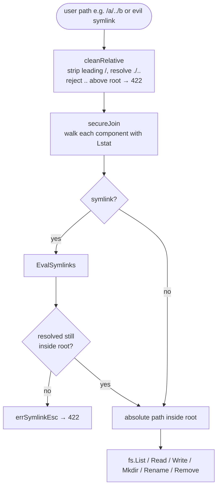

Disk quota: `Fs` tracks bytes and `reserve(delta)` rejects writes, uploads, and
renames that would exceed `disk_mb` with `507 insufficient_storage`. On every
workspace load, `Recheck()` recomputes usage with a `du` walk so external
changes can't drift the accounting.

---

## 7. Data model & on-disk layout

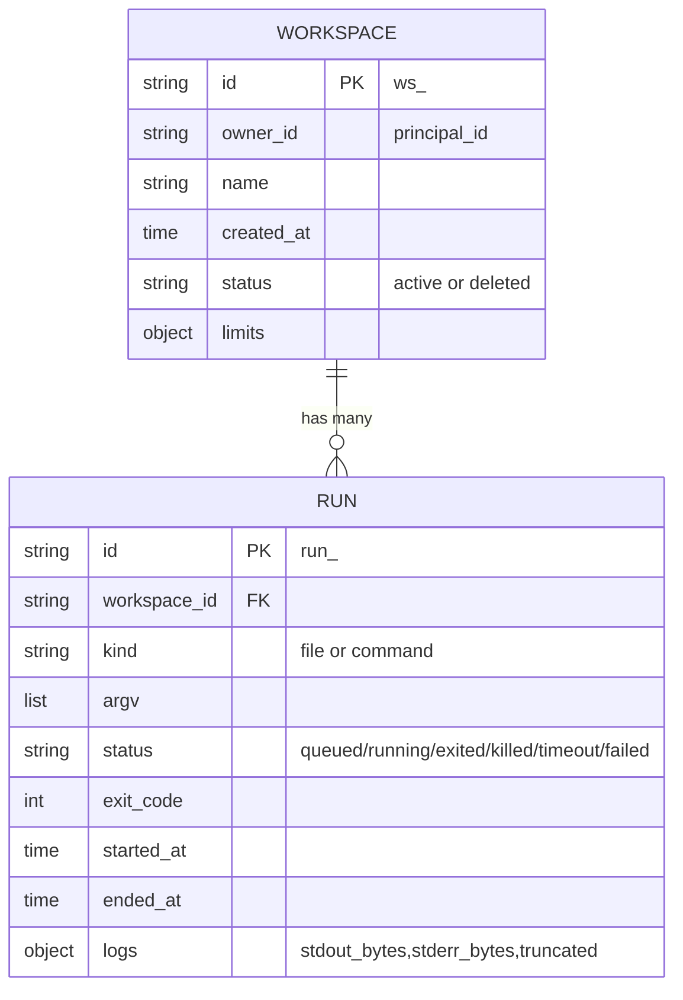

```
{data_dir}/
├── tmp/                                  transient nsjail configs + per-run /tmp
└── workspaces/
    └── {ws_id}/
        ├── meta.json                     workspace metadata (atomic write)
        ├── files/                        the workspace root (bind-mounted at /workspace)
        │   └── ...                        user files
        └── runs/
            └── {run_id}/
                ├── meta.json             run metadata (atomic on every transition)
                ├── stdout.log            capped run stdout
                └── stderr.log            capped run stderr
```

Metadata writes are **atomic**: write to a temp file in the same directory,
`fsync`, then `rename` over the target (`writeJSONAtomic`). Runs are retained per
workspace (last 100; pruned to 99 before each new run) to bound disk growth
without a background GC.

---

## 8. API surface at a glance

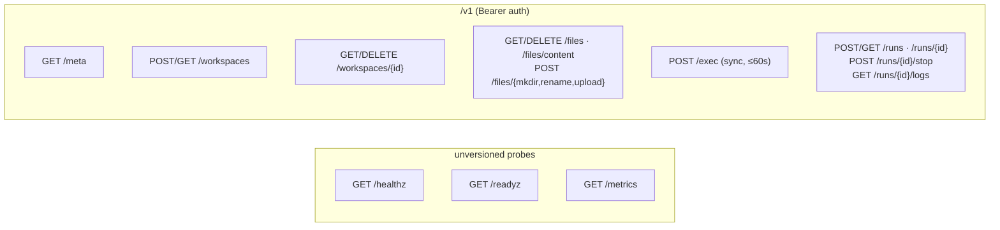

| Method & path | Purpose | Success | Common errors |
|---------------|---------|---------|---------------|
| `GET /healthz` | liveness | 200 | — |
| `GET /readyz` | data dir + nsjail present | 200 / 503 | 503 `{nsjail:false}` |
| `GET /metrics` | Prometheus text | 200 | — |
| `GET /v1/meta` | version, runtimes, default limits | 200 | 401 |
| `POST /v1/workspaces` | create | 201 | 400, 413 |
| `GET /v1/workspaces` | list owned | 200 | 401 |
| `GET /v1/workspaces/{id}` | get | 200 | 403, 404 |
| `DELETE /v1/workspaces/{id}` | stop runs + rm tree | 204 | 403, 404 |
| `GET /v1/workspaces/{id}/files?path=` | list dir | 200 | 422 unsafe |
| `GET .../files/content?path=` | read (raw / `?meta=true`) | 200 | 404, 422, 413 |
| `PUT .../files/content?path=` | write text/base64 | 204 | 507 quota |
| `DELETE .../files?path=` | delete | 204 | 404, 422 |
| `POST .../files/mkdir` | mkdir -p | 201 | 400, 422 |
| `POST .../files/rename` | rename | 204 | 404, 422 |
| `POST .../files/upload` | multipart upload | 201 | 413, 507 |
| `POST .../exec` | sync run | 200 | 422 bad cmd, 503 no nsjail |
| `POST .../runs` | async run | 202 | 400 |
| `GET .../runs` / `.../runs/{id}` | list / get | 200 | 404 |
| `POST .../runs/{id}/stop` | kill process group | 202 | 404 |
| `GET .../runs/{id}/logs` | poll logs | 200 | 404 |

All errors share one envelope:

```json
{"error":{"code":"unprocessable","message":"unsafe path: escapes workspace root"}}
```

---

## 9. Configuration reference

`configs/config.example.yaml` (loaded over built-in defaults by koanf):

```yaml
server:   { addr: "127.0.0.1:8080" }
storage:  { data_dir: "./data" }
sandbox:
  nsjail_path: "nsjail"      # missing → /readyz 503, runs → 503
  user: "sandbox"            # host user inside the jail
  group: "sandbox"
  kill_grace_sec: 3          # SIGTERM → SIGKILL grace
limits:                      # default per-workspace limits (overridable)
  cpu_cores: 1
  memory_mb: 512
  disk_mb: 1024
  max_wall_time_sec: 300
  max_runs: 3
caps:                        # hard ceilings, never overridable per request
  exec_stdout_kb: 256
  exec_stderr_kb: 256
  run_log_mb: 10
  json_body_mb: 1
  upload_mb: 50
  file_read_mb: 5
  file_write_mb: 10
keys:                        # static bearer keys → principal_id (1:N allowed)
  - { key: "dev-key-please-rotate", principal_id: "user_dev" }
```

`max_runs` maps to the cgroup `pids.max` as `max_runs * 64`.

---

## 10. Deployment & host requirements

nsjail needs to create namespaces, mount cgroup v2, and (when root) chown the
workspace. It therefore requires one of:

1. running sandboxd as **root**,
2. a **setuid** nsjail binary, or
3. a **privileged container**.

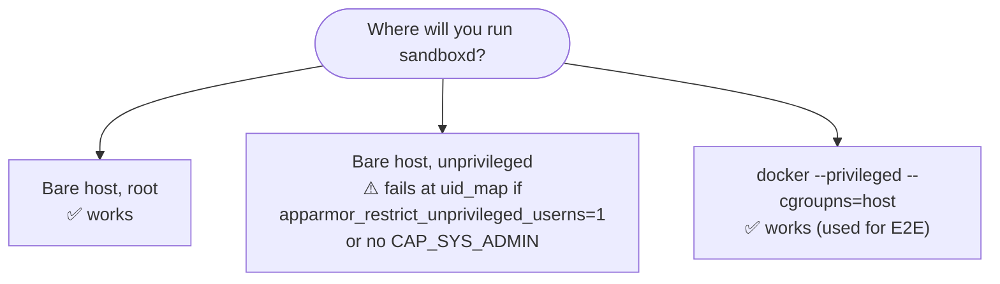

Observed on Ubuntu Noble (kernel 7.0, Go 1.26.8): with
`kernel.apparmor_restrict_unprivileged_userns = 1` and `CapEff=0`, nsjail cannot
write `uid_map` on the bare host. The verified E2E setup runs the server in a
privileged container:

```sh
docker run --rm --privileged --cgroupns=host -p 8080:8080 \
  -v "$PWD":/src -w /src ubuntu:24.04 \
  ./bin/sandboxd --config config.yaml
```

This is a **host restriction, not a sandboxd bug**; `/readyz` will accurately
report readiness as long as the data dir is writable and nsjail is found.

---

## 11. Verification & testing

Testing is layered so that most of the suite needs neither nsjail nor root:

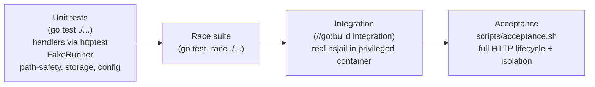

Evidence lives in [`docs/VERIFICATION.md`](VERIFICATION.md). Highlights from the
real-nsjail acceptance transcript:

| Check | Observed | Meaning |
|-------|----------|---------|
| traversal read/write/delete | 422 ×3 | path-safety works |
| symlink escape | 422 | symlink defense works |
| missing token / cross-owner | 401 / 403 | auth + ownership work |
| oversized body | 413 | caps work |
| network egress | `NET_BLOCKED: OSError` | net namespace isolates |
| `/etc/shadow` | `FileNotFoundError` | not mounted |
| `mount(2)`/`ptrace` | exit **159** (SIGSYS) | seccomp kills it |
| fork bomb | `FORKED 191` then `BlockingIOError` | cgroup pids limit |
| stop long run | status `killed`, no orphan | process-group kill |

`scripts/acceptance.sh` deliberately **refuses to run against the test stub**:
set `NSJAIL=/usr/local/bin/nsjail` and it will verify the binary is real.

---

## 12. Known limitations

Deferred to v0.1 (documented, not bugs):

- **SSE log streaming** — v0.0.5 polls logs with `offset`/`limit`.
- **Multi-node storage / sharding** — storage is a local filesystem.
- **Dynamic/DB authentication** — keys are static in config.
- **Per-UID-per-workspace isolation** — v0.0.5 uses a shared `sandbox` UID/GID
  with per-run user namespaces + cgroups.
- **Kernel-enforced per-run disk quota** — disk is accounted on the file API
  path and rechecked with `du`; the sandbox process is bounded by `rlimit_fsize`
  per file, not a total per-tree quota.
- **Bare-host unprivileged operation** — blocked by AppArmor unprivileged-userns
  restrictions on some kernels; run as root / setuid / privileged container.

---

## 13. Decision index

The 17 frozen product decisions live in [`docs/DECISIONS.md`](DECISIONS.md),
including the isolation model, network default-off, retention (100 runs),
exec-vs-runs split, disk-quota strategy, caps, path safety, process kill, error
envelope, ULID IDs, and health-probe semantics.

---

## 14. Glossary

| Term | Meaning |
|------|---------|
| **workspace** | Named, owned container of files + runs; `ws_<ULID>` |
| **run** | One async execution; `run_<ULID>` |
| **exec** | One synchronous execution (≤60 s), output returned inline |
| **principal** | Identity behind an API key; ownership is per-principal |
| **nsjail** | Linux sandbox tool built on namespaces, cgroups, seccomp, rlimits |
| **cgroup v2** | Unified Linux resource-control hierarchy |
| **seccomp** | Syscall filtering; sandboxd KILLs a dangerous denylist |
| **uidmap/gidmap** | Translation of in-namespace IDs to outside IDs |
| **ULID** | Lexicographically sortable, collision-resistant ID |
| **cap** | Hard output/body ceiling that requests cannot raise |
