# sandboxd — Architecture & Field Guide

> A complete walkthrough of what sandboxd is, how it is put together, why each
> piece exists, and how it actually behaves against a real `nsjail` kernel
> sandbox. Diagrams are [Mermaid](https://mermaid.js.org/); they render on
> GitHub/GitLab and in most Markdown viewers.

- Version: **0.0.5** (pre-alpha)
- Language: Go 1.23+
- Isolation: [`nsjail`](https://github.com/google/nsjail) (Linux namespaces,
  cgroups v2, seccomp, rlimits)
- Transport: HTTP/JSON, base path `/v1`
- Storage: local filesystem JSON (no database)

---

## 1. What is sandboxd, and what is it useful for?

sandboxd is a **secure, multi-tenant code-execution backend exposed over
HTTP/JSON**. It is a **headless sandbox engine**: its clients are **trusted
backend services**, not end users. A backend service (see
[Who consumes sandboxd](#who-consumes-sandboxd)) holds a bearer service key,
creates a *workspace* on a user's behalf, uploads files into it, and runs code
inside that workspace. The code runs in a locked-down `nsjail` sandbox with CPU,
memory, disk, and process limits, and with **no network by default**.

### The problem it solves

Running untrusted code is dangerous. A naive "run this Python" endpoint lets a
tenant:

- read the host's files (`/etc/shadow`, other tenants' data),
- reach the network and exfiltrate secrets or scan internal hosts,
- fork-bomb the machine, exhaust RAM, or fill the disk,
- leave orphan processes running forever,
- escape via path traversal or symlinks in the file API.

sandboxd defends against all of these with **defense in depth**: authentication +
ownership checks at the API layer, path-safety at the filesystem layer, and
kernel-enforced isolation at the execution layer.

### Typical use cases

| Use case | How sandboxd fits |
|----------|-------------------|
| Online code playground / IDE | Create workspace, upload `main.py`, `exec` to get output |
| Autograder / coding tests | Async `run` per submission, poll logs, stop on timeout |
| AI agent tool-use ("run this code") | Sync `exec` with hard 60 s cap and capped output |
| Data-transform jobs | Upload inputs, `run` a script, download results from the workspace |
| Plugin/extension sandbox | Confine third-party code with no network + resource caps |

### Who consumes sandboxd

sandboxd is a **headless sandbox engine**. Its clients are **trusted backend
services** that call it on a user's behalf — not the users themselves.

- **The bearer keys are service credentials held by an operator-owned
  frontend**, not user credentials. End users never see, hold, or send a
  sandboxd key; the frontend keeps it server-side and attaches it to every
  call. The static keys in `config.yaml` (`{key, principal_id}`) identify that
  frontend (or a handful of trusted backends), and `principal_id` is the
  ownership identity the service enforces.
- **The frontend is a separate product with its own repo** — for example a
  **Telegram bot product** that we are building separately. That product owns
  accounts, authentication, plans, quotas, rate limiting, billing and credential
  issuance, and calls cloud-service as a trusted backend client. Its internals
  are **not decided in this document**.
- **Out of scope for this repo, and owned by the frontend**: end-user accounts,
  sign-up, per-user quota, plans, rate limiting, billing, and credential
  issuance. This service neither implements nor enforces any of them.

See [DECISIONS.md](DECISIONS.md) #54 for the decision and its consequences.

### What it deliberately is *not* (v0.0.5)

Pre-alpha scope. It is a single-node, static-key service. Not yet: a hardened
public-internet multi-tenant platform, a distributed scheduler, or a
GPGPU/long-running job engine. See [§12 Known limitations](#12-known-limitations).
It must **not be exposed directly to end users**, and it is not a user account
or billing system (see [Who consumes sandboxd](#who-consumes-sandboxd)).

---

## 2. The 10,000-foot view

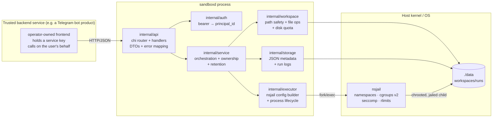

The flow is strictly layered:

- **api** knows HTTP, not the filesystem.
- **service** knows policy (ownership, limits, retention), not HTTP or nsjail
  internals.
- **workspace / storage / executor** are the three "hands": safe file I/O, JSON
  persistence, and process execution.

This separation is what lets the entire service be tested without `nsjail` (the
executor is an interface with a `FakeRunner`) and without a real HTTP socket
(`httptest`).

---

## 3. Package-by-package map

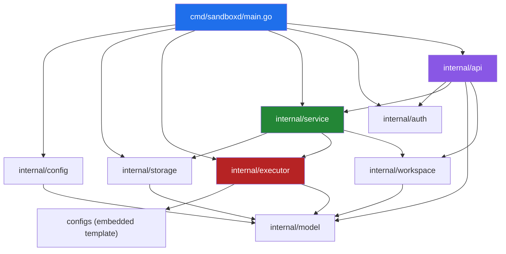

| Package | File(s) | Responsibility |
|---------|---------|----------------|
| `cmd/sandboxd` | `main.go` | Wire config → storage → executor → service → auth → HTTP server; graceful shutdown |
| `internal/config` | `config.go` | koanf YAML loader, defaults, byte-unit helpers |
| `internal/model` | `types.go`, `errors.go` | Domain types (Workspace, Run, Limits), ULID IDs, API error type |
| `internal/auth` | `auth.go` | Static bearer keys → `principal_id`, constant-time compare |
| `internal/api` | `router.go`, `*.go` | chi routes, handlers, DTOs, JSON error envelope, Prometheus metrics, audit log |
| `internal/service` | `service.go`, `files.go`, `exec.go`, `runs.go`, `control.go`, `packages.go`, `sessions.go` | Orchestration, ownership checks, limits, retention, run and session registries |
| `internal/workspace` | `fs.go`, `path.go` | Safe rooted filesystem, traversal/symlink defense, disk quota accounting |
| `internal/storage` | `store.go` | Atomic JSON metadata + run-log/session-output files on disk |
| `internal/executor` | `executor.go`, `nsjail.go`, `live.go`, `identity.go`, `fake.go`, `pty_relay.py` | nsjail config rendering, UID/GID mapping, one-shot and interactive process lifecycles, capped capture, PTY relay helper |
| `configs` | `nsjail_python.cfg.tmpl`, `embed.go` | nsjail TextProto template (also compiled into the binary) |
| `scripts` | `acceptance.sh`, `session-nsjail-check.sh`, `nsjail-stub.py` | End-to-end acceptance transcript; privileged real-nsjail terminal-session acceptance; test stub |

Total ≈ 6.4k lines of Go across 8 packages, plus one embedded template and an
OpenAPI 3.1 spec (`api/openapi.yaml`).

---

## 4. Request lifecycle (end to end)

### 4.1 The middleware + routing chain

Every request flows through a fixed chain before it reaches a handler:


Key subtlety: the **audit middleware** wants the `principal_id`, but context
values only flow *inward*, and `auth.Bearer` runs *after* audit. sandboxd solves
this with a `*string` **principal sink** placed in the context before routing;
the bearer middleware writes into it, and the audit middleware reads it after
the response. See `internal/auth/auth.go` and `internal/api/middleware.go`.

### 4.2 Synchronous `exec`

`POST /v1/workspaces/{id}/exec` runs one command and returns its output inline.
Hard cap: 60 s.

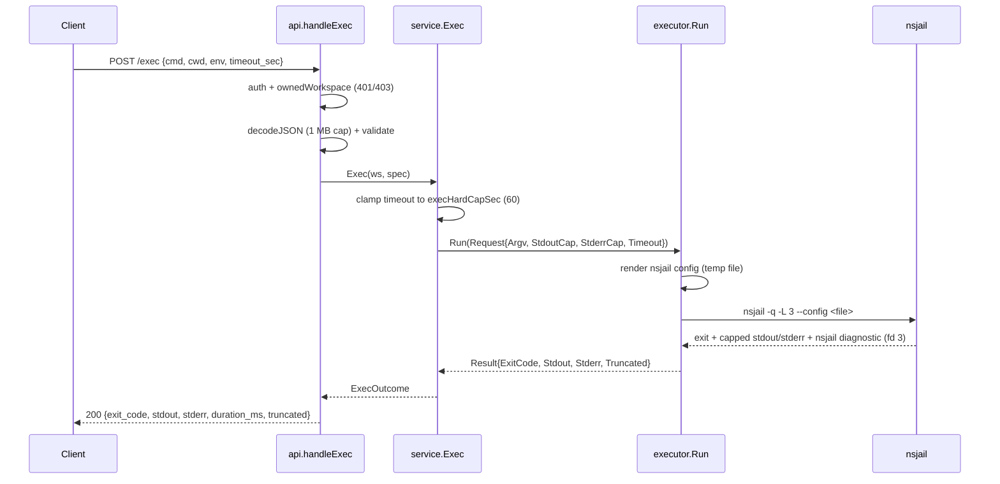

When nsjail cannot set up or launch the sandbox (exit 255 with a fatal
diagnostic), the runner returns `ErrSandboxUnavailable` and the API responds
`503 unavailable` with the nsjail diagnostic in `details.nsjail`.

### 4.3 Asynchronous `run`

`POST /v1/workspaces/{id}/runs` returns `202` immediately; the run continues in
a goroutine, its stdout/stderr are streamed to log files, and the client polls
`/runs/{runId}` and `/runs/{runId}/logs`.

```mermaid
sequenceDiagram
    participant C as Client
    participant API as api.handleCreateRun
    participant SVC as service.StartRun
    participant ST as storage
    participant G as executeRun goroutine
    participant EX as executor

    C->>API: POST /runs {kind, file|argv, args, cwd, interpreter, env, timeout_sec, no_timeout}
    API->>SVC: StartRun(ws, spec)
    SVC->>SVC: resolve+validate cwd; select interpreter (extension/override)
    SVC->>SVC: gate no_timeout (server AND workspace allow_unlimited_runs)
    SVC->>ST: PruneRuns(keep=99)
    SVC->>ST: CreateRun(meta.json + empty logs, cwd/timeout/unlimited/interpreter)
    SVC->>SVC: ctx, cancel = WithCancel()
    SVC->>G: go executeRun(ctx, ...)
    SVC-->>API: *Run (status=queued)
    API-->>C: 202 {run}

    G->>ST: SaveRun(status=running)
    G->>EX: Run(Request{Context:ctx, RunID, StdoutPath...})
    EX-->>G: Result (streamed to disk)
    G->>ST: SaveRun(status=exited|killed|timeout|failed)
    G->>G: close(rr.done), delete from registry

    C->>API: GET /runs/{id}/logs?offset=&limit=
    API->>ST: read stdout.log at offset
    API-->>C: {data, next, eof}
```

### 4.4 Run state machine

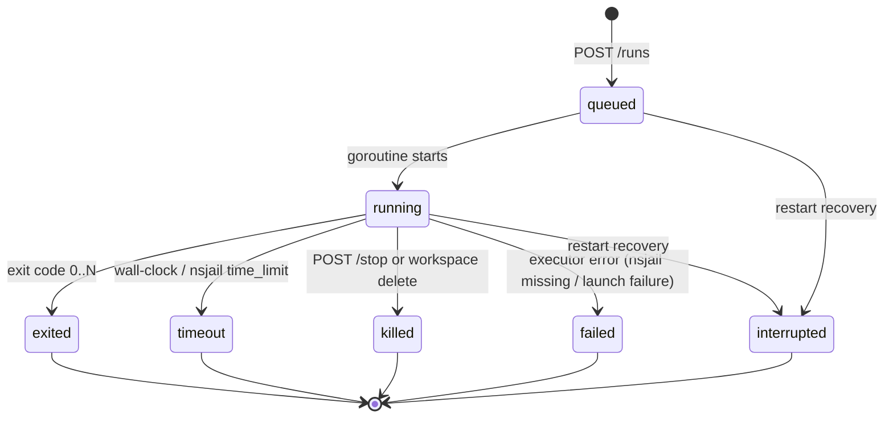

On startup the service sweeps runs still recorded `queued`/`running` and moves
them to the terminal `interrupted` state, because no sandbox process survives a
restart. Shutdown stops every running run and drains under a bounded deadline.

`stop` is **idempotent**: stopping an unknown or finished run returns the
current status and signals `false`. A stop both cancels the context and calls
`runner.Kill`, which kills the whole process group; when a live process was
signalled the response status is `killed`.

### 4.4.1 Interactive terminal sessions and the PTY relay

Sessions are the third execution mode alongside `exec` and `runs`. They differ
in one structural way: the process is **long-lived and driven by the client**.
A session's lifecycle is owned by a service goroutine (`runSession`) that waits
for the process, enforces timeouts, and records the terminal transition exactly
once.

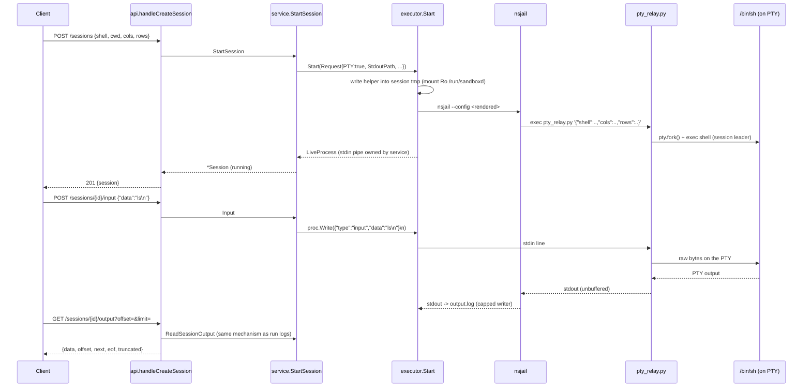

**Why a helper exists (measured).** `nsjail` exposes no PTY/tty option at all, so
it cannot allocate a controlling terminal. The sandbox image has no `socat` and
no `expect`, but its `python3` ships `pty`, `termios` and `fcntl`, and
`pty.fork()` gives a child a real `/dev/pts/N`. A ~200-line stdlib-only script is
therefore the smallest, most portable way to allocate a PTY. It is embedded in
the binary (`internal/executor/embed.go`) and materialized at `Start` time into
the session's private `/tmp`, which the executor already bind-mounts
**read-only** at `/run/sandboxd`. That the helper runs from a read-only mount
matters: the interactive shell cannot rewrite the code that allocates its
terminal, and the helper executes as the sandbox uid with the same mounts and
seccomp policy as any workload. No sandbox control is relaxed for sessions.

**The terminal needs two devices.** `pty.fork()` opens `/dev/ptmx` and needs a
working devpts, so a PTY session's config adds read-only binds of the host's
`/dev/pts` and `/dev/ptmx` (the `{{ if .PTY }}` block); a one-shot `exec` does
not get them. A private devpts instance does not work — `openpty()` opens
`/dev/ptmx`, which `newinstance` does not create. See
[DECISIONS.md](DECISIONS.md) #52 and [VERIFICATION.md](VERIFICATION.md) §9b for
the measured before/after. If the devices are missing the helper does **not**
leave a traceback in the stream: it writes `sandboxd-pty-error: …` to its own
stderr and exits non-zero, and the session is recorded `failed` with a
`diagnostic`.

**The control protocol.** The helper reads line-delimited JSON on its stdin and
performs exactly four operations: `{"type":"input","data":"..."}` (write bytes
to the PTY), `{"type":"signal","signal":"INT|TERM|QUIT|HUP|..."}` (signal the
PTY's foreground process group), `{"type":"resize","cols":N,"rows":M}`
(`TIOCSWINSZ`) and `{"type":"close"}` (SIGHUP, grace, SIGKILL). The `data` string
of an `input` message is written to the PTY as literal bytes and is **never**
re-parsed, so a client payload shaped like `{"type":"close"}` cannot become a
control message. The helper's stdout is the terminal stream verbatim: it injects
no JSON, sentinels or framing, so the client receives exactly the bytes a real
terminal produced.

**How output reuses the run-log mechanism.** The session's stdout is pointed at
`{data}/workspaces/{ws}/sessions/{ses}/output.log` through the same
`cappedWriter` that bounds a run log (here capped by `sessions.output_kb`).
`GET .../output` then reads the file by byte offset with the identical
`offset`/`next`/`eof`/`truncated` semantics as `GET .../runs/{id}/logs` — no
second streaming mechanism is invented, and a client's existing tail loop works
unchanged.

**State machine.**

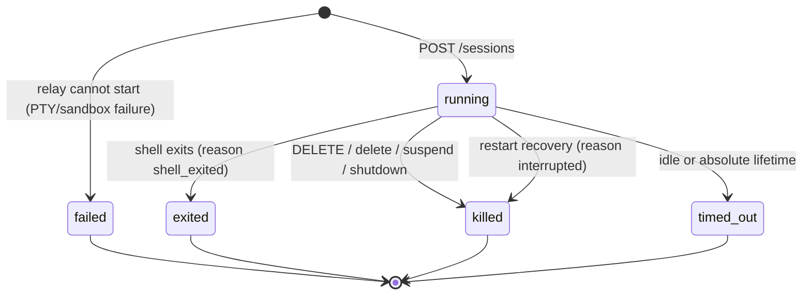

A goroutine per session (`watchSession`) enforces the idle timeout
(`sessions.idle_timeout_sec`) and the absolute lifetime
(`sessions.lifetime_sec`, or a shorter requested `timeout_sec`); either fires
`endSession`, which kills the process and records a pending reason. `runSession`
converts that reason into the terminal `status`/`reason` pair. Because the
session goroutine alone writes the terminal state and holds the session lock
across the metadata save, an in-flight input/resize activity update can never
persist a stale `running` status after the transition.

### 4.5 Workspace lifecycle (control plane)

Workspaces have their own small state machine, persisted in `meta.json` (the
`status` field) so it survives a restart:

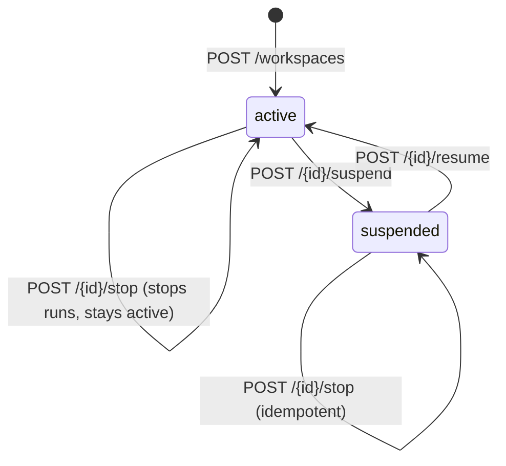

- **`suspend`** refuses *new* work (`exec`, run creation, session creation, and
  package management → `409 workspace_suspended`) while leaving the data
  readable, and stops every running/queued run and every live session. A session
  already open when the suspend happens is ended (reason `workspace_suspended`),
  because a suspended workspace must not keep running work.
- **`resume`** accepts work again; it does not restart anything.
- **`stop`** kills the workspace's running/queued runs but leaves it `active`
  (new work is still accepted). It is a distinct control from `suspend`: same
  kill path, opposite policy on future work.

Both `status` and the mutable `limits` are written through `store.UpdateWorkspace`
(atomic write-temp + rename), so a PATCH/suspend survives a process restart and
is re-projected on load.

**Control plane vs data plane.** The mutating, workspace-*state* endpoints are
the control plane — `PATCH /workspaces/{id}`, `POST .../{suspend,resume,stop}`,
the `DELETE .../runs*` purges, and package management
(`POST .../packages/install`, `DELETE .../packages`). They change what the
workspace *is* or *may do*. The data plane is everything that moves bytes or
runs a workload: file CRUD, `exec`, `POST/GET .../runs`, run logs, session
creation/input/output, and the read-only `GET .../usage` and `GET .../packages`
observations. The split is not just naming: **suspension gates the
work-starting control/data operations** (`exec`, `runs`, `sessions`, package
management) while pure reads still answer.

---

## 5. The isolation model (the heart of the project)

This is the part that actually makes sandboxd safe, and the part with the most
subtle real-world behavior.

### 5.1 What nsjail enforces, per run

Each run gets a fresh nsjail instance described by a config file rendered on the
fly (`configs/nsjail_python.cfg.tmpl`). The rendered sandbox has:

| Layer | Setting | Effect | Applied when |
|-------|---------|--------|--------------|
| Namespaces | `clone_newpid/ns/ipc/uts/user` always; network is always private (own ns) | Isolated PID, mount, IPC, UTS, user, network | always |
| mount ns | host `/usr`,`/lib`,`/lib64`,`/bin`,`/sbin` RO; workspace RW at `/workspace`; private `/tmp` | Child sees only the runtime + its own files | always |
| `/proc` | `mount_proc: false` | Host process table not visible | always |
| cgroup v2 | `cgroup_mem_max` (bytes), `cgroup_pids_max`, `cgroup_cpu_ms_per_sec` | Memory, process-count, CPU throttling | **only with `--cgroupns=host`** |
| rlimits | `as` (MB), `fsize` (MB), `nofile`, `nproc`, `core=0` | Kernel-enforced ceilings | always |
| seccomp | default-allow, KILL a dangerous denylist | `mount`, `ptrace`, `bpf`, `kexec_*`, `reboot`, `setns`, `unshare`, modules, keyctl, … | always |
| identity | uid/gid map + `--user sandbox` | Runs as the unprivileged `sandbox` user | always |
| time | `time_limit` | Wall-clock kill | always |

> **Units and availability (two corrected defects).** nsjail reads `rlimit_as`
> and `rlimit_fsize` in **megabytes**, not bytes: the renderer passes
> `memory_mb`/`disk_mb` directly (a bytes value made every ceiling ~10⁶× too
> large). cgroup v2 ceilings require write access to the host cgroup hierarchy,
> i.e. the container must run with `--cgroupns=host`; without it nsjail aborts
> before `execve` and **no** cgroup ceiling applies (see §5.4 and §10). The
> process ceiling comes from `cgroup_pids_max`, because `RLIMIT_NPROC` does not
> bind for the root-run sandbox.

### 5.2 The filesystem the sandbox sees

```mermaid
flowchart TB
    subgraph HOST["Host filesystem"]
        direction TB
        H1["/usr /lib /lib64 /bin /sbin\n(read-only bind)"]
        H2["/etc/{passwd,group,nsswitch.conf,ld.so.cache}\n/etc/ssl/certs /etc/alternatives\n(read-only bind)"]
        H3["/dev/{null,zero,urandom}\n(read-only bind)"]
        H10["/dev/pts + /dev/ptmx\n(read-only bind, ONLY for a PTY session)"]
        H7["/etc/{resolv.conf,hosts}\n(read-only bind, ONLY when allow_net)"]
        H8["shared packages dir\n(read-only bind, if configured)"]
        H9["{ws}/packages\n(read-write bind, per workspace)"]
        H4["/etc/shadow  → NOT mounted"]
        H5["host /proc   → NOT mounted"]
        H6["other tenants → NOT mounted"]
    end

    subgraph JAIL["Inside the nsjail mount namespace"]
        direction TB
        J1["/usr /lib /lib64 /bin /sbin\nRO"]
        J2["/etc/{passwd,group,...}\nRO"]
        J3["/dev/* RO"]
        J10["/dev/pts + /dev/ptmx RO\n(PTY session only)"]
        J4["/workspace  ← RW bind of\n./data/workspaces/{ws}/files"]
        J5["/tmp  ← RW private per-run dir"]
        J7["/etc/{resolv.conf,hosts}\nRO (allow_net only)"]
        J8["/opt/python/shared  ← RO bind\n(shared tier)"]
        J9["/opt/python/private ← RW bind\n(private tier)"]
        J6["cwd = /workspace\n(or a validated subdirectory)"]
    end

    H1 --> J1
    H2 --> J2
    H3 --> J3
    H10 --> J10
    H7 --> J7
    H8 --> J8
    H9 --> J9
    H4 -.->|absent| JAIL
    H5 -.->|absent| JAIL
    H6 -.->|absent| JAIL
```

**The `/dev` picture for a PTY session.** A one-shot `exec` sees only
`/dev/{null,zero,urandom}` — enough for a program that writes to stdout. A
**terminal session** additionally bind-mounts the host's `/dev/pts` and
`/dev/ptmx` read-only (`configs/nsjail_python.cfg.tmpl`, `{{ if .PTY }}`). This
is required but not exotic: nsjail exposes no PTY of its own, so the relay
helper allocates the terminal with `pty.fork()`, and CPython's `openpty()` opens
**`/dev/ptmx`** and passes it to `grantpt`/`unlockpt`, which need a working
**devpts**. Without those two mounts the helper fails with `out of pty devices`.

What this does and does not expose, stated plainly:

- **It exposes the host's pty pool (a terminal), not a filesystem or process
  view.** `/dev/pts` is where the kernel puts terminal slave nodes and
  `/dev/ptmx` is the multiplexer that allocates them; a pty carries a byte
  stream and a window size, nothing else. The sandbox cannot read another
  tenant's files or see a host process through it.
- **A private devpts instance is not a substitute.** `mount { dst: "/dev/pts"
  fstype: "devpts" options: "newinstance,..." }` makes `/dev/pts/ptmx` appear but
  does **not** create `/dev/ptmx`, which is what `openpty()` opens; measured, it
  fails with ENOENT. Binding the host's devices is the measured minimum.
- **Isolation is otherwise unchanged.** The uid/gid map, the seccomp deny list,
  `clone_newnet`/`clone_newns`/`clone_newpid`/… and `mount_proc: false` are all
  identical to a one-shot run; the two new mounts are read-only binds of device
  nodes, not new privileges. A PTY session is a normal sandbox process that
  happens to have a controlling terminal.

**Package tiers in the mount picture.** A workload imports from two tiers, added
to the interpreter's search path via `PYTHONPATH`, **shared first, private
second**:

- `/opt/python/shared` — bind-mounted **read-only** (`rw:false`) from a single
  host directory (`packages.shared_dir`). One package set, visible to every
  workspace, and **no workspace can write it**; that kernel-enforced `rw:false`
  is why the shared set can be trusted across tenants. It is omitted entirely if
  the directory is missing/unreadable, and a run then degrades to private-only.
- `/opt/python/private` — bind-mounted **read-write** (`rw:true`) from
  `{data_dir}/workspaces/{ws_id}/packages`, chowned to the workspace's sandbox
  uid. Writable because `pip install` targets it, and per-workspace because it
  lives in the workspace's own tree (deleted with the workspace). A package
  installed here is importable only in that workspace.

**Conditional DNS mounts.** `/etc/resolv.conf` and `/etc/hosts` are bind-mounted
read-only **only when `allow_net` is true**. Without `allow_net`, the network
namespace is empty and there is nothing to resolve, so no resolver is exposed;
with `allow_net`, the mounted resolver names **public** resolvers reached
through the workspace's chained-slirp4netns egress (see §5.6). The host's own
resolver is never published to a workspace.

Consequences proven by the acceptance transcript: a jailed process cannot read
`/etc/shadow` (`FileNotFoundError` — it simply isn't mounted) and dies with
`SIGSYS` if it calls `mount(2)` or `ptrace`. A workspace without `allow_net`
cannot open a network socket (`OSError`); a workspace with `allow_net` can reach
the public internet and a public resolver but not the host LAN (measured by
[`scripts/tunnel-check.sh`](../scripts/tunnel-check.sh)).

### 5.3 UID/GID mapping — the trickiest part

Linux only lets an unprivileged process write a **single-entry** uid/gid map
whose *outside* id equals its own effective id. sandboxd maps the sandbox
identity *inside* the namespace onto an id that is permitted *outside*,
depending on how the orchestrator is running:

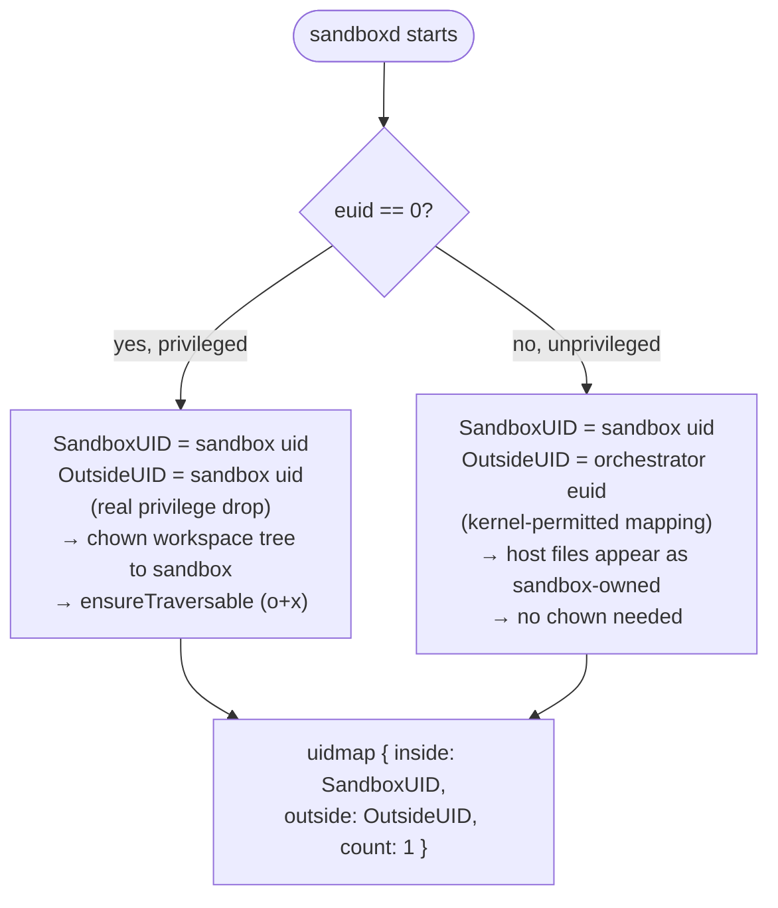

This dual behavior is why the service works both as root and as a normal user
(with the caveat in §10 about unprivileged user namespaces being disabled by
some kernels/AppArmor).

### 5.4 Why real nsjail is finicky (discovered during E2E)

The nsjail TextProto schema is **strict** — an unknown field is a hard parse
error. Getting to a green real-nsjail run required:

- Remove invalid fields `chroot`, `chroot_base`, `disable_proc`, `proc_path`;
  use `mount_proc: false`.
- `use_cgroupv2: true` is required for the unified cgroup hierarchy on modern
  hosts; `cgroup_mem_max` is in **bytes**, but **`rlimit_as`/`rlimit_fsize` are
  in megabytes** (a subtle unit mismatch that is now covered by a test).
- cgroup v2 is only usable when the container is started with
  `--cgroupns=host`; otherwise nsjail aborts before `execve`.
- `uidmap`/`gidmap` `inside_id`/`outside_id` must be quoted **strings**.
- The seccomp policy string format is `KILL { sys1, sys2 }\nDEFAULT ALLOW` (no
  `POLICY`/`USE` wrapper); libseccomp knows `umount` not `umount2`, and not
  `_sysctl`.
- `exec_bin.path` goes straight to `execve` — **no PATH lookup** — so argv[0]
  is resolved to an absolute path on the host first (valid inside because the
  host `/usr`,`/bin` are bind-mounted at identical paths).
- nsjail's own diagnostics are routed to a dedicated log fd (3) so a setup or
  launch failure is captured separately from the child's stdout/stderr and
  surfaced as `503 unavailable` instead of a silent exit 255.

These findings are encoded in the template and `internal/executor/nsjail.go`.

### 5.5 Process-group termination

`exec.Cmd` is started with `Setpgid: true`. `stop` and timeout send `SIGTERM` to
`-pgid`, wait the grace period (default 3 s), then `SIGKILL` to `-pgid`. The
acceptance run confirms `python3 long.py` is present before stop and gone after.
Context cancellation is wired to the same group-kill via `cmd.Cancel`.


### 5.6 Egress and name resolution inside the jail

An `allow_net` workspace is in its **own** network namespace, connected to the
public internet only through **chained slirp4netns**:

```
workspace ns --slirp(UNIX socket)--> relay ns --slirp(UNIX socket)--> host
```

slirp4netns speaks to its parent over a UNIX socket and creates a tap interface
only inside the *child* namespace, so there are **zero host interfaces, routes or
veth pairs**. The engine-owned relay namespace carries a blackhole route for
every operator-private range, so a workspace reaches the public internet and a
public resolver but never the host LAN. (The earlier `clone_newnet: false`
host-network share is gone; see [DECISIONS.md](DECISIONS.md) #64.)

Name resolution is a *userspace* resolver problem: libc reads `/etc/resolv.conf`
and `/etc/hosts`. Both are bind-mounted read-only **conditional on `allow_net`**
(`{{ if .AllowNet }}` in the template), but the mounted `resolv.conf` names
**public** resolvers (`network.resolver`) — the host's own resolver is never
published. A workspace without `allow_net` gets a private, empty namespace and
no resolver. Render tests pin both directions
(`TestRenderConfigMountsResolverWhenNetAllowed`,
`TestRenderConfigOmitsResolverWhenNetDenied`); the live egress and isolation are
measured by [`scripts/tunnel-check.sh`](../scripts/tunnel-check.sh); see
[VERIFICATION.md §8 and §9g](VERIFICATION.md).

---

## 6. File safety & disk quota

All file API paths are user-controlled, so they pass through two gates:


`Stat` uses `resolveFinal`, a variant that does not follow a symlink in the
final component so the link itself (type, target) can be reported, while still
rejecting a link whose target escapes the root.

Disk quota: `Fs` tracks bytes and `reserve(delta)` rejects writes, uploads, and
renames that would exceed `disk_mb` with `507 insufficient_storage`. On every
workspace load, `Recheck()` recomputes usage with a `du` walk so external
changes can't drift the accounting.

---

## 7. Data model & on-disk layout

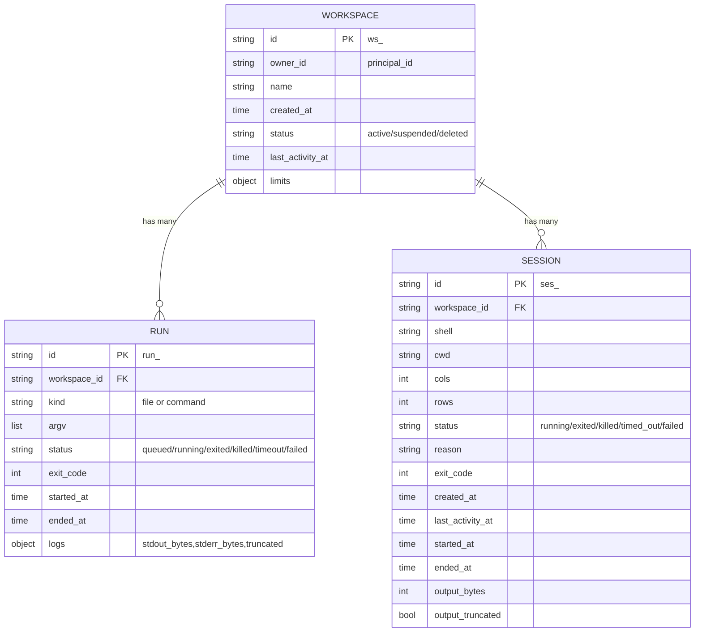

```
{data_dir}/
├── tmp/                                  transient nsjail configs + per-run /tmp
└── workspaces/
    └── {ws_id}/
        ├── meta.json                     workspace metadata (atomic write)
        ├── files/                        the workspace root (bind-mounted at /workspace)
        │   └── ...                        user files
        ├── packages/                     PRIVATE package tier (bind-mounted
        │   └── ...                        writable at /opt/python/private)
        ├── runs/
        │   └── {run_id}/
        │       ├── meta.json             run metadata (atomic on every transition)
        │       ├── stdout.log            capped run stdout
        │       └── stderr.log            capped run stderr
        └── sessions/
            └── {ses_id}/
                ├── meta.json             session metadata (atomic on every transition)
                └── output.log            capped PTY output stream
```

Metadata writes are **atomic**: write to a temp file in the same directory,
`fsync`, then `rename` over the target (`writeJSONAtomic`). Runs are retained per
workspace (last 100; pruned to 99 before each new run) to bound disk growth
without a background GC.

---

## 8. API surface at a glance

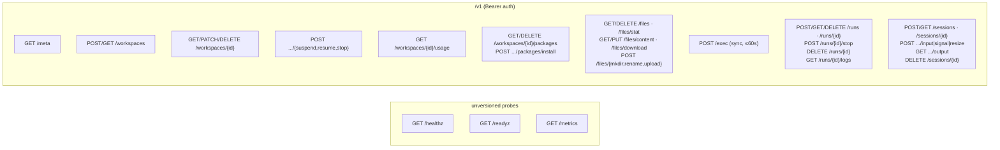

| Method & path | Purpose | Success | Common errors |
|---------------|---------|---------|---------------|
| `GET /healthz` | liveness | 200 | — |
| `GET /readyz` | data dir + nsjail present | 200 / 503 | 503 `{nsjail:false}` |
| `GET /metrics` | Prometheus text | 200 | — |
| `GET /v1/meta` | version, runtimes, default limits | 200 | 401 |
| `POST /v1/workspaces` | create | 201 | 400, 413, 422 |
| `GET /v1/workspaces` | list owned | 200 | 401 |
| `GET /v1/workspaces/{id}` | get | 200 | 403, 404 |
| `PATCH /v1/workspaces/{id}` | update name/limits at runtime | 200 | 400, 422 |
| `DELETE /v1/workspaces/{id}` | stop runs + rm tree | 204 | 403, 404 |
| `POST .../{id}/suspend` | refuse new work + stop runs | 200 | 404 |
| `POST .../{id}/resume` | accept work again | 200 | 404 |
| `POST .../{id}/stop` | stop all runs, stay active | 200 | 404 |
| `GET .../{id}/usage` | disk bytes, run counters, limits | 200 | 404 |
| `GET .../{id}/packages` | private-tier packages + shared status | 200 | 403, 404 |
| `POST .../{id}/packages/install` | pip install into private tier | 200 | 422 bad req, 409 suspended, 503 |
| `DELETE .../{id}/packages` | remove one (`?name=`) / all (`?all=true`) | 204 / 200 | 400, 404 |
| `GET .../files?path=` | list dir (bounded page, metadata) | 200 | 422 unsafe, 422 `not_directory` (a file) |
| `GET .../files/stat?path=` | metadata for one path | 200 | 404, 422 |
| `GET .../files/content?path=` | read whole / byte range / line range (raw or `?meta=true`) | 200 | 404, 413, 422, 422 `not_directory` |
| `GET .../files/download?path=` | stream the entire file (exempt from `file_read_mb`) | 200 | 404, 422, 422 `not_directory` |
| `PUT .../files/content?path=` | write text/base64 (`content` required) | 204 | 400, 507 quota, 422 `not_directory` |
| `DELETE .../files?path=` | delete | 204 | 404, 422 |
| `POST .../files/mkdir` | mkdir -p | 201 | 400, 422 |
| `POST .../files/rename` | rename | 204 | 404, 422 |
| `POST .../files/upload` | multipart upload | 201 | 413, 507 |
| `POST .../exec` | sync run | 200 | 422 bad cmd, 409 suspended, 503 no nsjail |
| `POST .../runs` | async run | 202 | 400, 409 suspended |
| `GET .../runs` / `.../runs/{id}` | list (filter/page) / get | 200 | 400, 404 |
| `DELETE .../runs` / `.../runs/{id}` | purge finished runs / one run | 200 / 204 | 409 running |
| `POST .../runs/{id}/stop` | kill process group | 202 | 404 |
| `GET .../runs/{id}/logs` | poll logs | 200 | 404 |
| `POST .../sessions` | start interactive PTY session | 201 | 409 suspended/sessions, 422 |
| `GET .../sessions` / `.../sessions/{id}` | list (filter/page) / get | 200 | 400, 404 |
| `POST .../sessions/{id}/input` | write bytes to the PTY | 204 | 409 ended, 413 |
| `POST .../sessions/{id}/signal` | signal foreground process group | 204 | 409 ended, 422 |
| `POST .../sessions/{id}/resize` | `TIOCSWINSZ` | 204 | 409 ended, 422 |
| `GET .../sessions/{id}/output` | poll PTY output by offset | 200 | 409 ended |
| `DELETE .../sessions/{id}` | graceful close (idempotent) | 200 | 404 |

All errors share one envelope:

```json
{"error":{"code":"unprocessable","message":"unsafe path: escapes workspace root"}}
```

---

## 9. Configuration reference

`configs/config.example.yaml` (loaded over built-in defaults by koanf):

```yaml
server:   { addr: "127.0.0.1:8080" }
storage:  { data_dir: "./data" }
sandbox:
  nsjail_path: "nsjail"      # missing → /readyz 503, runs → 503
  user: "sandbox"            # host user inside the jail
  group: "sandbox"
  kill_grace_sec: 3          # SIGTERM → SIGKILL grace
limits:                      # default per-workspace limits (overridable)
  cpu_cores: 1
  memory_mb: 512
  disk_mb: 1024
  max_wall_time_sec: 300
  max_runs: 3
max_limits:                  # hard server maxima (create + PATCH enforced)
  cpu_cores: 8
  memory_mb: 8192
  disk_mb: 51200
  max_wall_time_sec: 3600
  max_runs: 64
caps:                        # hard ceilings, never overridable per request
  exec_stdout_kb: 256
  exec_stderr_kb: 256
  run_log_mb: 10
  json_body_mb: 1
  upload_mb: 50
  file_read_mb: 5
  file_write_mb: 10
  file_list_max: 1000
packages:                    # two-tier Python packages
  shared_dir: "/opt/sandboxd/packages"       # RO bind; empty disables
  shared_enabled: true
  shared_requirements: ""    # optional, informational only
  install_timeout_sec: 120
  install_output_kb: 256
sessions:                    # interactive terminal sessions (all defaulted)
  max_per_workspace: 4       # 409 too_many_sessions past this
  idle_timeout_sec: 900      # no activity → timed_out/idle_timeout
  lifetime_sec: 3600         # absolute ceiling → timed_out/lifetime
  output_kb: 1024            # capped PTY output log
  max_input_kb: 64           # per-request input cap
  shell: "/bin/sh"           # default shell in the image
  kill_grace_sec: 3          # SIGHUP → SIGKILL grace
  start_probe_ms: 250        # startup reap window → honest failed vs running
keys:                        # service bearer keys → principal_id (1:N allowed);
                             # held by the frontend, never by end users
  - { key: "dev-key-please-rotate", principal_id: "user_dev" }
```

`max_runs` maps to the cgroup `pids.max` as `max_runs * 64`.

---

## 10. Deployment & host requirements

nsjail needs to create namespaces, mount cgroup v2, and (when root) chown the
workspace. It therefore requires one of:

1. running sandboxd as **root**,
2. a **setuid** nsjail binary, or
3. a **privileged container**.

In addition, cgroup v2 ceilings (memory, pids, cpu) require the container to run
with **`--cgroupns=host`** so nsjail can write the host cgroup subtree. Without
it nsjail aborts before `execve`; the service reports `cgroups:false` on
`/readyz` and returns `503 unavailable` (naming the nsjail diagnostic) for every
execution.

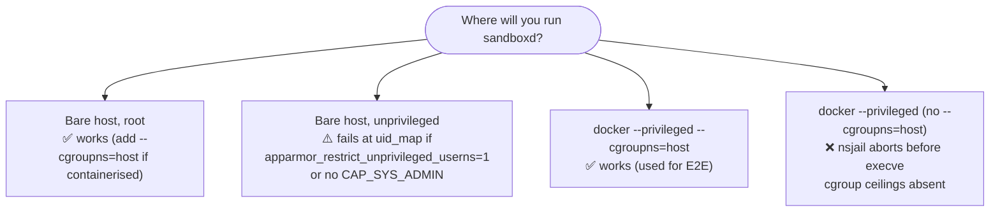

Observed on Ubuntu Noble (kernel 7.0, Go 1.26.8): with
`kernel.apparmor_restrict_unprivileged_userns = 1` and `CapEff=0`, nsjail cannot
write `uid_map` on the bare host. The verified E2E setup runs the server in a
privileged container:

```sh
docker run --rm --privileged --cgroupns=host -p 8080:8080 \
  -v "$PWD":/src -w /src ubuntu:24.04 \
  ./bin/sandboxd --config config.yaml
```

This is a **host restriction, not a sandboxd bug**. `/readyz` reports `nsjail`
and `cgroups` separately so an operator can tell which requirement is missing.

---

## 11. Verification & testing

Testing is layered so that most of the suite needs neither nsjail nor root:

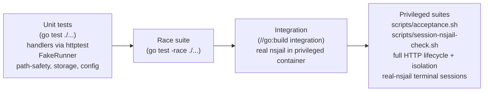

Both `scripts/acceptance.sh` and `scripts/session-nsjail-check.sh` are the
**privileged suites**: `acceptance.sh` runs the full HTTP lifecycle + isolation
transcript (normally inside the `--privileged --cgroupns=host` image via
`make acceptance`), and `session-nsjail-check.sh` runs the terminal-session
acceptance against real nsjail on the host (via `make session-check`; no
container, but root + a real nsjail).

Evidence lives in [`docs/VERIFICATION.md`](VERIFICATION.md). Highlights from the
real-nsjail acceptance transcript:

| Check | Observed | Meaning |
|-------|----------|---------|
| traversal read/write/delete | 422 ×3 | path-safety works |
| symlink escape | 422 | symlink defense works |
| missing token / cross-owner | 401 / 403 | auth + ownership work |
| oversized body | 413 | caps work |
| network egress | `NET_BLOCKED: OSError` | net namespace isolates |
| `/etc/shadow` | `FileNotFoundError` | not mounted |
| `mount(2)`/`ptrace` | exit **159** (SIGSYS) | seccomp kills it |
| memory ceiling (`RLIMIT_AS`) | `AS_LIMIT_MB 512`, 1 GiB alloc denied | rlimit unit fix holds |
| fork bomb | `FORKED 191` then `BlockingIOError` | cgroup pids limit |
| stop long run | status `killed`, no orphan | process-group kill |
| launch failure (no `--cgroupns=host`) | 503 + nsjail diagnostic | failure is explicit |

`scripts/acceptance.sh` deliberately **refuses to run against the test stub**:
set `NSJAIL=/usr/local/bin/nsjail` and it will verify the binary is real.

---

## 12. Known limitations

Deferred to v0.1 (documented, not bugs):

- **SSE log streaming** — v0.0.5 polls logs with `offset`/`limit`.
- **Multi-node storage / sharding** — storage is a local filesystem.
- **Dynamic/DB authentication** — keys are static in config (bearer auth itself
  is exercised by `TestAuth*`).
- **Per-UID-per-workspace isolation** — v0.0.5 uses a shared `sandbox` UID/GID
  with per-run user namespaces + cgroups.
- **Kernel-enforced per-run disk quota** — disk is accounted on the file API
  path and rechecked with `du`; the sandbox process is bounded by `rlimit_fsize`
  per file (now correctly in MB), not a total per-tree quota.
- **Process ceiling** — `RLIMIT_NPROC` does not bind for the root-run sandbox;
  the ceiling is provided by `cgroup_pids_max`, hence cgroup v2
  (`--cgroupns=host`) is mandatory.
- **Bare-host unprivileged operation** — blocked by AppArmor unprivileged-userns
  restrictions on some kernels; run as root / setuid / privileged container.

---

## 13. Decision index

The 58 frozen product decisions live in [`docs/DECISIONS.md`](DECISIONS.md),
including the isolation model, network default-off, retention (100 runs),
exec-vs-runs split, disk-quota strategy, caps, path safety, process kill, error
envelope, ULID IDs, health-probe semantics, the cgroup/rlimit/env/lifecycle
corrections, run recovery, the workspace control plane (runtime-mutable limits,
suspend vs stop, run filter/purge, usage accounting), the two-tier package model,
the conditional resolver mounts, terminal sessions (the PTY helper vs its
alternatives, stdin-pipe vs `--pass_fd`, signal-vs-stop, idle/lifetime values,
restart/cleanup, output reuse and injection-proofing), the engine/frontend
product boundary (#54), and first-class file browsing/viewing (#55–58).

---

## 14. Glossary

| Term | Meaning |
|------|---------|
| **workspace** | Named, owned container of files + runs; `ws_<ULID>` |
| **run** | One async execution; `run_<ULID>` |
| **exec** | One synchronous execution (≤60 s), output returned inline |
| **session** | One interactive terminal with a real PTY; `ses_<ULID>` |
| **PTY relay helper** | Stdlib-only Python script that allocates the PTY and relays the control protocol inside the sandbox |
| **principal** | Identity behind a service bearer key; ownership is per-principal. The key is held by the frontend, not by an end user |
| **nsjail** | Linux sandbox tool built on namespaces, cgroups, seccomp, rlimits |
| **cgroup v2** | Unified Linux resource-control hierarchy |
| **seccomp** | Syscall filtering; sandboxd KILLs a dangerous denylist |
| **uidmap/gidmap** | Translation of in-namespace IDs to outside IDs |
| **ULID** | Lexicographically sortable, collision-resistant ID |
| **cap** | Hard output/body ceiling that requests cannot raise |
