# sandboxd — Architecture & Field Guide

> A complete walkthrough of what sandboxd is, how it is put together, why each
> piece exists, and how it actually behaves against a real `nsjail` kernel
> sandbox. Diagrams are [Mermaid](https://mermaid.js.org/); they render on
> GitHub/GitLab and in most Markdown viewers.

- Version: **0.0.20** (pre-alpha)
- Language: Go 1.23+
- Isolation: [`nsjail`](https://github.com/google/nsjail) (Linux namespaces,
  cgroups v2, seccomp, rlimits)
- Transport: HTTP/JSON, base path `/v1`
- Storage: local filesystem JSON (no database)

---

## 1. What is sandboxd, and what is it useful for?

sandboxd is a **secure, multi-tenant code-execution backend exposed over
HTTP/JSON**. It is a **headless sandbox engine**: its clients are **trusted
backend services**, not end users. A backend service (see
[Who consumes sandboxd](#who-consumes-sandboxd)) holds a bearer service key,
creates a *workspace* on a user's behalf, uploads files into it, and runs code
inside that workspace. The code runs in a locked-down `nsjail` sandbox with CPU,
memory, disk, and process limits, and with **no network by default**.

### The problem it solves

Running untrusted code is dangerous. A naive "run this Python" endpoint lets a
tenant:

- read the host's files (`/etc/shadow`, other tenants' data),
- reach the network and exfiltrate secrets or scan internal hosts,
- fork-bomb the machine, exhaust RAM, or fill the disk,
- leave orphan processes running forever,
- escape via path traversal or symlinks in the file API.

sandboxd defends against all of these with **defense in depth**: authentication +
ownership checks at the API layer, path-safety at the filesystem layer, and
kernel-enforced isolation at the execution layer.

### Typical use cases

| Use case | How sandboxd fits |
|----------|-------------------|
| Online code playground / IDE | Create workspace, upload `main.py`, `exec` to get output |
| Autograder / coding tests | Async `run` per submission, poll logs, stop on timeout |
| AI agent tool-use ("run this code") | Sync `exec` with hard 60 s cap and capped output |
| Data-transform jobs | Upload inputs, `run` a script, download results from the workspace |
| Plugin/extension sandbox | Confine third-party code with no network + resource caps |

### Who consumes sandboxd

sandboxd is a **headless sandbox engine**. Its clients are **trusted backend
services** that call it on a user's behalf — not the users themselves.

- **The bearer keys are service credentials held by an operator-owned
  frontend**, not user credentials. End users never see, hold, or send a
  sandboxd key; the frontend keeps it server-side and attaches it to every
  call. The static keys in `config.yaml` (`{key, principal_id}`) identify that
  frontend (or a handful of trusted backends), and `principal_id` is the
  ownership identity the service enforces.
- **The frontend is a separate product with its own repo** — for example a
  **Telegram bot product** that we are building separately. That product owns
  accounts, authentication, plans, quotas, rate limiting, billing and credential
  issuance, and calls cloud-service as a trusted backend client. Its internals
  are **not decided in this document**.
- **Out of scope for this repo, and owned by the frontend**: end-user accounts,
  sign-up, per-user quota, plans, rate limiting, billing, and credential
  issuance. This service neither implements nor enforces any of them.

See [DECISIONS.md](DECISIONS.md) #54 for the decision and its consequences.

### What it deliberately is *not* (v0.0.20)

Pre-alpha scope. It is a single-node, static-key service. Not yet: a hardened
public-internet multi-tenant platform, a distributed scheduler, or a
GPGPU/long-running job engine. See [§12 Known limitations](#12-known-limitations).
It must **not be exposed directly to end users**, and it is not a user account
or billing system (see [Who consumes sandboxd](#who-consumes-sandboxd)).

---

## 2. The 10,000-foot view

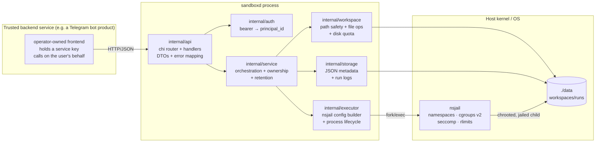

The flow is strictly layered:

- **api** knows HTTP, not the filesystem.
- **service** knows policy (ownership, limits, retention), not HTTP or nsjail
  internals.
- **workspace / storage / executor** are the three "hands": safe file I/O, JSON
  persistence, and process execution.

This separation is what lets the entire service be tested without `nsjail` (the
executor is an interface with a `FakeRunner`) and without a real HTTP socket
(`httptest`).

---

## 3. Package-by-package map

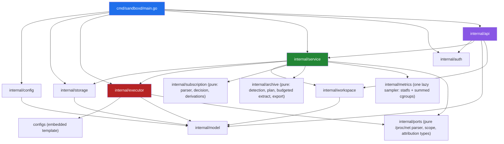

| Package | File(s) | Responsibility |
|---------|---------|----------------|
| `cmd/sandboxd` | `main.go` | Wire config → storage → executor → service → auth → HTTP server; graceful shutdown |
| `internal/config` | `config.go` | koanf YAML loader, defaults, byte-unit helpers |
| `internal/model` | `types.go`, `errors.go` | Domain types (Workspace, Run, Limits), ULID IDs, API error type |
| `internal/auth` | `auth.go` | Static bearer keys → `principal_id`, constant-time compare |
| `internal/api` | `router.go`, `*.go` | chi routes, handlers, DTOs, JSON error envelope, Prometheus metrics, audit log |
| `internal/service` | `service.go`, `files.go`, `exec.go`, `runs.go`, `control.go`, `packages.go`, `sessions.go`, `subscription.go` | Orchestration, ownership checks, limits, retention, run and session registries, and the subscription lifecycle + reaper loop |
| `internal/subscription` | `subscription.go` | The PURE subscription parts: the duration-grammar parser, the reaper decision function `Decide(now, sub, grace)`, and the derived summary numbers. No I/O, no daemon |
| `internal/archive` | `format.go`, `plan.go`, `extract.go`, `export.go`, `engine.go`, `errors.go` | The PURE native-archive engine: content-based format detection, the validated extraction plan, the streaming budget, extraction, and directory export. No shell tool, no direct filesystem access (writes go through a `Sink`) |
| `internal/metrics` | `metrics.go`, `sampler.go`, `reader.go` | The per-workspace resource stream: the snapshot/frame types and percentages, the ONE lazily-started service-wide sampler with its subscriber registry and coalescing, and the production `statfs`+cgroup reader. Pure entry points, injected `Provider`/`Reader` for tests |
| `internal/workspace` | `fs.go`, `path.go`, `diskfs.go` | Safe rooted filesystem, traversal/symlink defense, disk quota accounting, and the per-workspace fuse2fs ext4 image manager |
| `internal/storage` | `store.go` | Atomic JSON metadata + run-log/session-output files on disk |
| `internal/executor` | `executor.go`, `nsjail.go`, `live.go`, `identity.go`, `ports.go`, `fake.go`, `pty_relay.py` | nsjail config rendering, UID/GID mapping, one-shot and interactive process lifecycles, capped capture, PTY relay helper, and the bounded `/proc/<pid>/net/*` + `/proc/<pid>/fd` port read |
| `internal/ports` | `parse.go`, `discover.go` | The PURE port/service discovery parts: the `/proc/net/{tcp,tcp6,udp,udp6,unix}` line parser (hex address incl. IPv6, hex port, LISTEN state), scope derivation and deterministic sort, and the socket-inode -> process attribution/report types. No I/O |
| `configs` | `nsjail_python.cfg.tmpl`, `embed.go` | nsjail TextProto template (also compiled into the binary) |
| `scripts` | `acceptance.sh`, `session-nsjail-check.sh`, `subscription-check.sh`, `archive-check.sh`, `ports-check.sh`, `nsjail-stub.py` | End-to-end acceptance transcript; privileged real-nsjail terminal-session + subscription + archive + port-discovery acceptance; test stub |

Total ≈ 6.4k lines of Go across 8 packages, plus one embedded template and an
OpenAPI 3.1 spec (`api/openapi.yaml`).

---

## 4. Request lifecycle (end to end)

### 4.1 The middleware + routing chain

Every request flows through a fixed chain before it reaches a handler:


Key subtlety: the **audit middleware** wants the `principal_id`, but context
values only flow *inward*, and `auth.Bearer` runs *after* audit. sandboxd solves
this with a `*string` **principal sink** placed in the context before routing;
the bearer middleware writes into it, and the audit middleware reads it after
the response. See `internal/auth/auth.go` and `internal/api/middleware.go`.

### 4.2 Synchronous `exec`

`POST /v1/workspaces/{id}/exec` runs one command and returns its output inline.
Hard cap: 60 s.

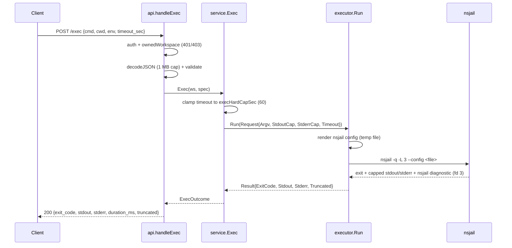

When nsjail cannot set up or launch the sandbox (exit 255 with a fatal
diagnostic), the runner returns `ErrSandboxUnavailable` and the API responds
`503 unavailable` with the nsjail diagnostic in `details.nsjail`.

### 4.3 Asynchronous `run`

`POST /v1/workspaces/{id}/runs` returns `202` immediately; the run continues in
a goroutine, its stdout/stderr are streamed to log files, and the client polls
`/runs/{runId}` and `/runs/{runId}/logs`.

```mermaid
sequenceDiagram
    participant C as Client
    participant API as api.handleCreateRun
    participant SVC as service.StartRun
    participant ST as storage
    participant G as executeRun goroutine
    participant EX as executor

    C->>API: POST /runs {kind, file|argv, args, cwd, interpreter, env, timeout_sec, no_timeout}
    API->>SVC: StartRun(ws, spec)
    SVC->>SVC: resolve+validate cwd; select interpreter (extension/override)
    SVC->>SVC: gate no_timeout (server AND workspace allow_unlimited_runs)
    SVC->>ST: PruneRuns(keep=99)
    SVC->>ST: CreateRun(meta.json + empty logs, cwd/timeout/unlimited/interpreter)
    SVC->>SVC: ctx, cancel = WithCancel()
    SVC->>G: go executeRun(ctx, ...)
    SVC-->>API: *Run (status=queued)
    API-->>C: 202 {run}

    G->>ST: SaveRun(status=running)
    G->>EX: Run(Request{Context:ctx, RunID, StdoutPath...})
    EX-->>G: Result (streamed to disk)
    G->>ST: SaveRun(status=exited|killed|timeout|failed)
    G->>G: close(rr.done), delete from registry

    C->>API: GET /runs/{id}/logs?offset=&limit=
    API->>ST: read stdout.log at offset
    API-->>C: {data, next, eof}
```

### 4.4 Run state machine

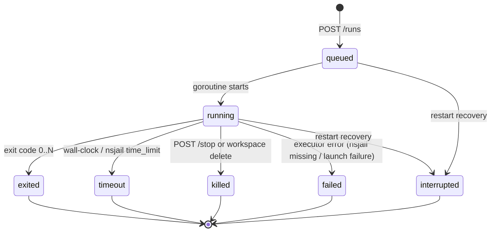

On startup the service sweeps runs still recorded `queued`/`running` and moves
them to the terminal `interrupted` state, because no sandbox process survives a
restart. Shutdown stops every running run and drains under a bounded deadline.

`stop` is **idempotent**: stopping an unknown or finished run returns the
current status and signals `false`. A stop both cancels the context and calls
`runner.Kill`, which kills the whole process group; when a live process was
signalled the response status is `killed`.

### 4.4.1 Interactive terminal sessions and the PTY relay

Sessions are the third execution mode alongside `exec` and `runs`. They differ
in one structural way: the process is **long-lived and driven by the client**.
A session's lifecycle is owned by a service goroutine (`runSession`) that waits
for the process, enforces timeouts, and records the terminal transition exactly
once.

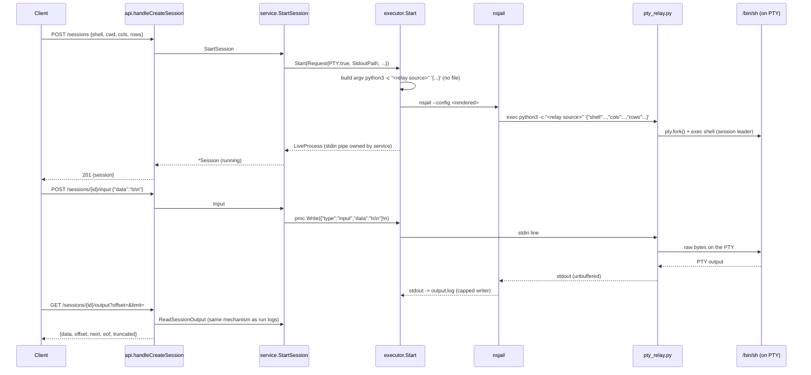

**Why a helper exists (measured).** `nsjail` exposes no PTY/tty option at all, so
it cannot allocate a controlling terminal. The sandbox image has no `socat` and
no `expect`, but its `python3` ships `pty`, `termios` and `fcntl`, and
`pty.fork()` gives a child a real `/dev/pts/N`. A ~200-line stdlib-only script is
therefore the smallest, most portable way to allocate a PTY. It is embedded in
the binary (`internal/executor/embed.go`) and passed to the interpreter
**inline** as the argument to `python3 -c` (see ADR 78): it never exists as a
file inside the sandbox, so there is no helper source for a tenant to read and
no engine-named path. The helper executes as the sandbox uid with the same
mounts and seccomp policy as any workload. No sandbox control is relaxed for
sessions.

**The terminal needs two devices.** `pty.fork()` opens `/dev/ptmx` and needs a
working devpts, so a PTY session's config adds read-only binds of the host's
`/dev/pts` and `/dev/ptmx` (the `{{ if .PTY }}` block); a one-shot `exec` does
not get them. A private devpts instance does not work — `openpty()` opens
`/dev/ptmx`, which `newinstance` does not create. See
[DECISIONS.md](DECISIONS.md) #52 and [VERIFICATION.md](VERIFICATION.md) §9b for
the measured before/after. If the devices are missing the helper does **not**
leave a traceback in the stream: it writes `sandboxd-pty-error: …` to its own
stderr and exits non-zero, and the session is recorded `failed` with a
`diagnostic`.

**The control protocol.** The helper reads line-delimited JSON on its stdin and
performs exactly four operations: `{"type":"input","data":"..."}` (write bytes
to the PTY), `{"type":"signal","signal":"INT|TERM|QUIT|HUP|..."}` (signal the
PTY's foreground process group), `{"type":"resize","cols":N,"rows":M}`
(`TIOCSWINSZ`) and `{"type":"close"}` (SIGHUP, grace, SIGKILL). The `data` string
of an `input` message is written to the PTY as literal bytes and is **never**
re-parsed, so a client payload shaped like `{"type":"close"}` cannot become a
control message. The helper's stdout is the terminal stream verbatim: it injects
no JSON, sentinels or framing, so the client receives exactly the bytes a real
terminal produced.

**How output reuses the run-log mechanism.** The session's stdout is pointed at
`{data}/workspaces/{ws}/sessions/{ses}/output.log` through the same
`cappedWriter` that bounds a run log (here capped by `sessions.output_kb`).
`GET .../output` then reads the file by byte offset with the identical
`offset`/`next`/`eof`/`truncated` semantics as `GET .../runs/{id}/logs` — no
second streaming mechanism is invented, and a client's existing tail loop works
unchanged.

**State machine.**

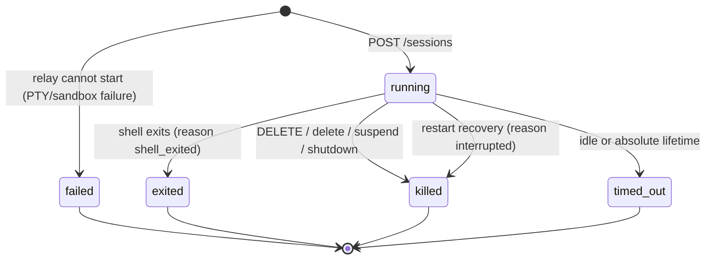

A goroutine per session (`watchSession`) enforces the idle timeout
(`sessions.idle_timeout_sec`) and the absolute lifetime
(`sessions.lifetime_sec`, or a shorter requested `timeout_sec`); either fires
`endSession`, which kills the process and records a pending reason. `runSession`
converts that reason into the terminal `status`/`reason` pair. Because the
session goroutine alone writes the terminal state and holds the session lock
across the metadata save, an in-flight input/resize activity update can never
persist a stale `running` status after the transition.

### 4.5 Workspace lifecycle (control plane)

Workspaces have their own small state machine, persisted in `meta.json` (the
`status` field) so it survives a restart:

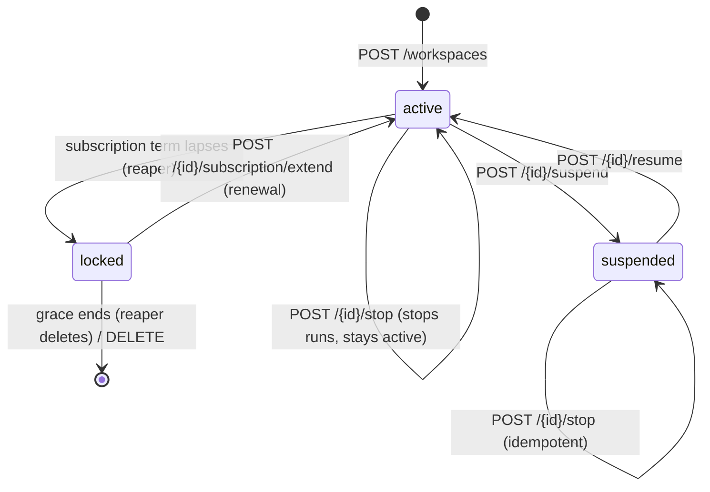

- **`suspend`** refuses *new* work (`exec`, run creation, session creation, and
  package management → `409 workspace_suspended`) while leaving the data
  readable, and stops every running/queued run and every live session. A session
  already open when the suspend happens is ended (reason `workspace_suspended`),
  because a suspended workspace must not keep running work.
- **`resume`** accepts work again; it does not restart anything.
- **`stop`** kills the workspace's running/queued runs but leaves it `active`
  (new work is still accepted). It is a distinct control from `suspend`: same
  kill path, opposite policy on future work.
- **`locked`** is the automatic consequence of a lapsed subscription term; it is
  driven by a periodic reaper (not an API call) and the way out is a renewal
  (`POST /{id}/subscription/extend`), not `resume`. The API renders the
  **derived** status, so a lapsed-but-not-yet-reaped workspace already reads
  `locked`. See §4.6.

Both `status` and the mutable `limits` are written through `store.UpdateWorkspace`
(atomic write-temp + rename), so a PATCH/suspend survives a process restart and
is re-projected on load.

**Control plane vs data plane.** The mutating, workspace-*state* endpoints are
the control plane — `PATCH /workspaces/{id}`, `POST .../{suspend,resume,stop}`,
the `DELETE .../runs*` purges, and package management
(`POST .../packages/install`, `DELETE .../packages`). They change what the
workspace *is* or *may do*. The data plane is everything that moves bytes or
runs a workload: file CRUD, `exec`, `POST/GET .../runs`, run logs, session
creation/input/output, and the read-only `GET .../usage` and `GET .../packages`
observations. The split is not just naming: **suspension gates the
work-starting control/data operations** (`exec`, `runs`, `sessions`, package
management) while pure reads still answer.

### 4.6 Subscriptions and the reaper (a term enforced by a clock, not a counter)

A workspace may carry a **subscription**: a `model.Subscription` of *absolute*
instants (`GrantedAt`, `ExpiresAt`, `RenewedAt`, `LockedAt`, `GraceEndsAt`,
`Extensions`). This service is a pure sandbox engine, so it owns the **clock**
and the **enforcement** but not billing: it stores an absolute expiry and a
renewal is the client sending a new/extended expiry. Nothing about a term lives
in memory — it is recomputed from the stored instants, so a restart is trivially
correct.

The pure half lives in `internal/subscription`:

- `ParseDuration` — the `s m h d w mo y` grammar (`mo`=30d, `y`=365d are
  fixed-length approximations). A bare integer is refused.
- `Decide(now, sub, grace)` — the reaper's whole policy as one pure function:
  `none` while live or when unlimited, `lock` from `expires_at`, `delete` from
  `expires_at + grace`. A `delete` is refused while `now` is before a recorded
  `LockedAt` (the backwards-clock rule).
- `Derivations` — the cheap summary numbers (`state`, `remaining_sec`, …).

The impure half is `internal/service/subscription.go`: `StartReaper` copies the
`disk_watchdog.go` shape (one goroutine, one `time.NewTicker`, one done channel),
started from `main` beside it and gated by `subscription.enabled`. Each tick
calls `ReapSubscriptions(now)`, which for every workspace with an expiry applies
the pure decision: **lock** (stop runs, kill sessions/detached processes, delete
tunnels, unmount the disk image — keeping every byte of data) or **delete**
(unmount, purge files/`disk.img`/metadata). Lock and delete are idempotent and
crash-safe, one workspace's failure is logged and never stops the loop, and a
workspace with no subscription is never selected. The clock is injected
(`func() time.Time`) so a test — and the acceptance harness, through a compressed
config clock — assert days-long semantics in seconds. The `summary` exposed on
the get and the list is the same pure `Derivations` output, so it can never
disagree with enforcement.

### 4.7 Native archives (an untrusted input, validated before a byte is written)

Archive handling is an **in-engine** feature, not a shell-out: this host has no
RAR tool at all, and a security boundary cannot live in a host binary that may
be absent or different. The engine uses Go's `archive/zip` and
`github.com/nwaples/rardecode/v2` (pure Go, MIT, no cgo). RAR is **read-only** —
its encoder is proprietary, so export writes only ZIP.

The pure half lives in `internal/archive` and never touches the filesystem
directly; the service supplies a `Sink` backed by the workspace's symlink-safe,
quota-accounted streaming writers (`internal/service/archive.go`):

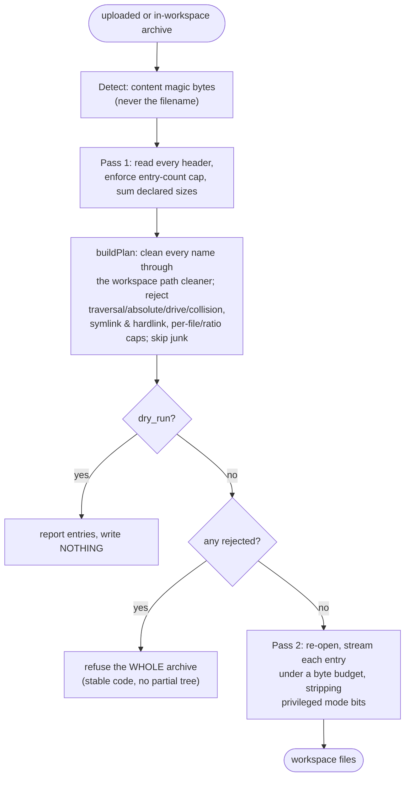

The load-bearing properties are:

- **Detection is content-based.** A `.zip` that is really a RAR still works; an
  unknown format is `415 unsupported_archive` naming the detected signature.
- **Validate-then-write.** The whole header list is read and decided before the
  first byte is written, so a refused archive leaves **no** partial tree.
- **A streaming budget, not a header promise.** The bytes actually written are
  bounded by `max_total_mb`/`max_file_mb`, so a header that lies about its size
  cannot overshoot.
- **Links are refused, not resolved.** A symlink or hardlink entry is never
  materialized, so the engine never has to decide whether a target is safe.
- **Modes are sanitized.** `setuid`/`setgid`/sticky bits are stripped.

The three routes (`POST /files/archive`, `POST /files/extract`,
`GET /files/archive`) and their stable refusal codes are documented in
[docs/API.md](API.md#native-archives) and [SPEC.md](SPEC.md) §2.3.1; the
decisions are recorded in [DECISIONS.md](DECISIONS.md) ADR 92, and
`scripts/archive-check.sh` asserts the whole boundary against real nsjail and a
real FUSE disk.

### 4.8 The per-workspace resource stream (one lazy sampler over statfs + cgroups)

The resource stream pushes a workspace's RAM and disk every 3s, cheaply enough
that thousands of workspaces cause no pressure. It is one package,
`internal/metrics`, whose cost model is fixed by **measurement** (ADR 93):

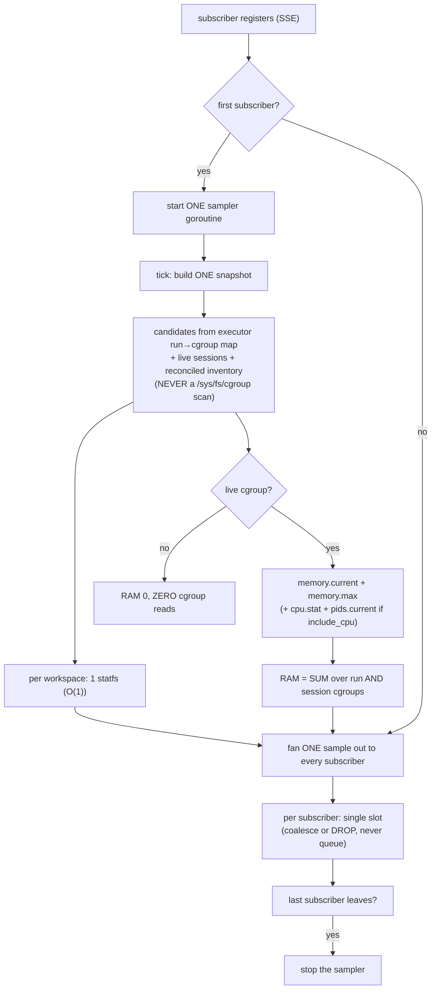

The load-bearing properties are:

- **`statfs`, never a tree walk.** Disk is one O(1) call (~1.7 µs); the walk
  `Service.Usage()` does is 153 µs/file (82×). A `tree_walk_reads` counter stays
  0 as a contract guard.
- **RAM is the SUM over cgroups.** The cgroup is per run/session, not per
  workspace; `memory.max` is a per-`_run` ceiling (documented, not changed).
- **One sampler, lazily started.** Starts on the first subscriber, stops on the
  last, so an unwatched service costs exactly zero.
- **Sample once, fan out.** Cost is independent of subscriber count.
- **Idle elision.** No live cgroup → RAM 0, zero file reads, one statfs.
- **Coalesce, never queue.** One pending frame per stream; drops are counted.

The four routes and the frame shape are in
[docs/API.md](API.md#get-v1metrics); the SPEC surface is §2.2; the decisions are
ADR 93; and `scripts/metrics-check.sh` asserts the whole contract against real
nsjail and a real FUSE disk.

### 4.8a The per-workspace write-RATE ceiling (sampled, default off)

DISK TOTAL, RAM and CPU each have a real per-workspace ceiling; write RATE now
has a **SAMPLED** one. A kernel throttle is unavailable (`io.max` does not
account the write on ZFS; ADR 95), and a byte-bucket in the engine's own write
path would miss a tenant's own `dd`. Instead the write-rate watchdog rides the
resource stream's tick (it starts **no timer of its own**): per workspace it
computes `delta = used_now − used_prev` over a monotonic interval and, after
`N` (`disk.write_rate_samples`, default 3) **consecutive** over-limit samples,
stops the offending run with the distinct `rate_limited` outcome. The engine's
own write path (an API write/upload, an archive extraction) is refused with
`429 write_rate_exceeded` while over the ceiling, so both sources are covered.
It is **default off** (`disk.write_rate_enabled`), the overshoot is stated as a
number and is not a kernel boundary, and `write_rate_mb_s > disk_mb` is refused.
See ADR 95 and `scripts/write-rate-check.sh`.

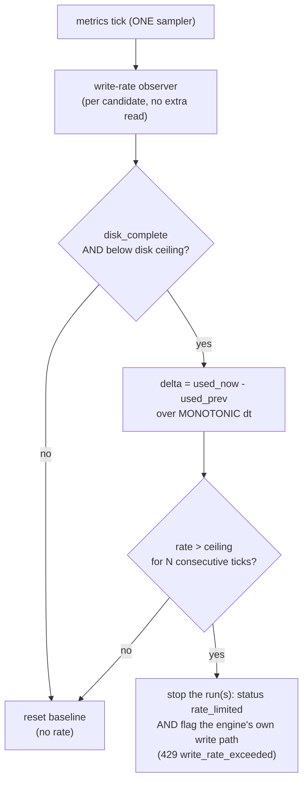

### 4.8b Native port/service discovery (on-demand, never on the tick)

`GET /v1/workspaces/{id}/ports` answers what a workspace is listening on and
which process serves each one, so a client can say "your app is live on port
8080". It exists because the tenant **cannot** answer it itself: the curated
`/proc` carries no `/proc/net` (ADR 86) and neither `ss` nor `netstat` is
installed. The read is **on demand**, one request at a time, and is deliberately
**not** part of the resource stream: a single `/proc/<pid>/net/tcp` open is
measured at **~4.6 ms**, and 4.6 ms × 1000 workspaces would add **4.6 s** to
every 3-second tick (ADR 96).

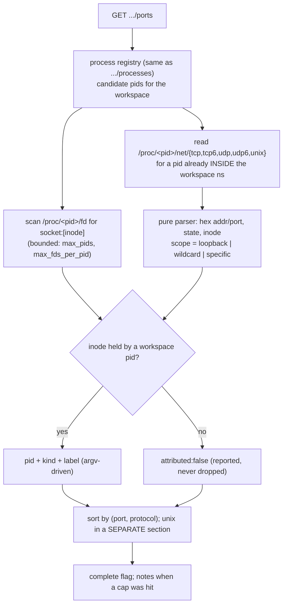

The load-bearing properties are:

- **The tenant cannot see this itself**, which is why the endpoint is the only
  answer: no `/proc/net`, no `ss`, no `netstat` inside.
- **`/proc/<pid>/net/*`, not `ip netns exec ... ss`.** The pid is already inside
  the workspace's slirp-created namespace; `ip netns exec net:[...]` fails on
  this host (measured). Reading `/proc/<pid>/net/*` needs no namespace handling.
- **Scoped to the workspace's own pids**, so a host port or another tenant's port
  can never appear — the isolation property `scripts/ports-check.sh` proves.
- **On-demand, never on the tick.** A monotonic `reads_total` counter (in
  `/v1/meta`) does not move across a metrics tick and does move on a `/ports`
  request, so the gate proves the cost decision without being vacuous.
- **Honest**: a port whose owner cannot be resolved is reported `attributed:
  false`; a bound hit sets `complete:false` rather than a partial list that looks
  total; UDP has no `LISTEN` state and is not given one.
- **Not reachability.** A port here is inside the workspace; publishing needs a
  **tunnel** (`limits.allow_tunnels` **and** `tunnels.enabled`), so every
  response carries a plain reachability note.

The route and frame shape are in [docs/API.md](API.md#get-v1workspacesworkspaceidports);
the decision is ADR 96; and `scripts/ports-check.sh` asserts the whole contract
against real nsjail.

---

## 5. The isolation model (the heart of the project)

This is the part that actually makes sandboxd safe, and the part with the most
subtle real-world behavior.

### 5.1 What nsjail enforces, per run

Each run gets a fresh nsjail instance described by a config file rendered on the
fly (`configs/nsjail_python.cfg.tmpl`). The rendered sandbox has:

| Layer | Setting | Effect | Applied when |
|-------|---------|--------|--------------|
| Namespaces | `clone_newpid/ns/ipc/uts/user` always; network is always the workspace's **own** namespace (never the host's) | Isolated PID, mount, IPC, UTS, user, network | always |
| network ns (egress) | `allow_net:false` → private **empty** ns (no egress). `allow_net:true` → own ns reaching the internet only through **chained slirp4netns** over UNIX sockets; the relay blackholes every operator-private range (see §5.6) | Egress without host-network sharing | always; egress fabric itself needs `network.enabled` |
| mount ns | host `/usr`,`/lib`,`/lib64`,`/bin`,`/sbin` RO; workspace RW at `/workspace`; private `/tmp` | Child sees only the runtime + its own files | always |
| `/proc` | `mount_proc: false`; a CURATED per-workspace `/proc` payload (meminfo/cpuinfo/stat/uptime/loadavg/version/vmstat/mounts) is bound RO over it | Host process/network/kernel view not visible; the workspace sees only its OWN resource facts (`free -h`, `vmstat`, a bare `df` work) | `disk.proc_enabled` (default on) **and** `identity.enabled` |
| `/workspace` | a real per-workspace ext4 image (fuse2fs, host-side mount) sized to `disk_mb` | `df`/`stat -f`/`os.statvfs()` report the workspace's own allowance; a write past it fails `ENOSPC` (kernel boundary, no overshoot) | `disk.enabled` (default on); falls back to a sampled used-bytes watchdog |
| cgroup v2 | ONE parent cgroup per workspace (`ws-<id>`) carries `memory.max` (bytes), `pids.max`, `cpu.max`; nsjail is pointed at it via `cgroupv2_mount`, so every run's leaf cgroup is created **inside** it | Per-WORKSPACE memory / process-count / CPU throttling, enforced as the SUM across concurrent runs (ADR 94) | **only with `--cgroupns=host`** |
| Resource stream | the workspace's real disk growth (`statfs`), sampled once per metrics tick | Per-WORKSPACE write-RATE ceiling, **SAMPLED** (stops the run with `rate_limited` after N over-limit samples; not a kernel boundary) | `disk.write_rate_enabled` (default **off**) + `limits.write_rate_mb_s` (ADR 95) |
| rlimits | `as` (MB), `fsize` (MB), `nofile`, `nproc`, `core=0` | Kernel-enforced ceilings | always |
| seccomp | default-allow, KILL a dangerous denylist | `mount`, `ptrace`, `bpf`, `kexec_*`, `reboot`, `setns`, `unshare`, modules, keyctl, … | always |
| identity | uid/gid map + `--user sandbox` | Runs as the unprivileged `sandbox` user | always |
| host-identity mask | read-only `/etc/ld.so.preload` + shim at the opaque `/run/.rt.so`; `uname`/`sysinfo`/`sysconf`/`sched_getaffinity`/`getauxval` answer with the workspace's limits | No platform kernel string, host size or hardware fingerprint by syscall | `identity.enabled` (default on); a not-ready mask aborts the run |
| zero-signal curation | curated read-only `/usr/{bin,sbin,lib,local}`, `/lib`, `/usr/share/{doc,man}`, `/etc/{passwd,group,ssl/certs}` overlays that drop engine/platform names (ADR 74, 77) | No engine tool name, provider account, engine env or engine/platform string in any reachable file | `identity.hide_provider_tools` (default on); a missing curated tree aborts the run |
| time | `time_limit` | Wall-clock kill | always |

> **Units and availability (two corrected defects).** nsjail reads `rlimit_as`
> and `rlimit_fsize` in **megabytes**, not bytes: the renderer passes MB values
> (a bytes value made every ceiling ~10⁶× too large). `rlimit_fsize` is the
> disk limit; `rlimit_as` is **not** `memory_mb` but `memory_mb + headroom`
> (floored at 2048 MB), because a managed runtime reserves a large *virtual*
> address space it never commits and `RLIMIT_AS` counts reservations (ADR 82):
> the physical ceiling is the workspace parent cgroup's `memory.max = memory_mb`
> (ADR 94). cgroup v2 ceilings require write access to the host cgroup
> hierarchy, i.e. the container must run with `--cgroupns=host`; without it
> nsjail aborts before `execve` and **no** cgroup ceiling applies (see §5.4 and
> §10). The process ceiling comes from `pids.max` on the workspace parent,
> because `RLIMIT_NPROC` does not bind for the root-run sandbox.

### 5.2 The filesystem the sandbox sees

```mermaid
flowchart TB
    subgraph HOST["Host filesystem"]
        direction TB
        H1["/usr /lib /lib64 /bin /sbin\n(read-only bind)"]
        H2["/etc/{passwd,group,nsswitch.conf,ld.so.cache}\n/etc/ssl/certs /etc/alternatives\n(read-only bind)"]
        H3["/dev/{null,zero,urandom}\n(read-only bind)"]
        H10["/dev/pts + /dev/ptmx\n(read-only bind, ONLY for a PTY session)"]
        H7["/etc/{resolv.conf,hosts}\n(read-only bind, ONLY when allow_net)"]
        H8["shared packages dir\n(read-only bind, if configured)"]
        H9["{ws}/packages\n(read-write bind, per workspace)"]
        H4["/etc/shadow  → NOT mounted"]
        H5["host /proc   → NOT mounted"]
        H6["other tenants → NOT mounted"]
    end

    subgraph JAIL["Inside the nsjail mount namespace"]
        direction TB
        J1["/usr /lib /lib64 /bin /sbin\nRO"]
        J2["/etc/{passwd,group,...}\nRO"]
        J3["/dev/* RO"]
        J10["/dev/pts + /dev/ptmx RO\n(PTY session only)"]
        J4["/workspace  ← RW bind of\n./data/workspaces/{ws}/files"]
        J5["/tmp  ← RW private per-run dir"]
        J7["/etc/{resolv.conf,hosts}\nRO (allow_net only)"]
        J8["/opt/python/shared  ← RO bind\n(shared tier)"]
        J9["/opt/python/private ← RW bind\n(private tier)"]
        J6["cwd = /workspace\n(or a validated subdirectory)"]
    end

    H1 --> J1
    H2 --> J2
    H3 --> J3
    H10 --> J10
    H7 --> J7
    H8 --> J8
    H9 --> J9
    H4 -.->|absent| JAIL
    H5 -.->|absent| JAIL
    H6 -.->|absent| JAIL
```

**The `/dev` picture for a PTY session.** A one-shot `exec` sees only
`/dev/{null,zero,urandom}` — enough for a program that writes to stdout. A
**terminal session** additionally bind-mounts the host's `/dev/pts` and
`/dev/ptmx` read-only (`configs/nsjail_python.cfg.tmpl`, `{{ if .PTY }}`). This
is required but not exotic: nsjail exposes no PTY of its own, so the relay
helper allocates the terminal with `pty.fork()`, and CPython's `openpty()` opens
**`/dev/ptmx`** and passes it to `grantpt`/`unlockpt`, which need a working
**devpts**. Without those two mounts the helper fails with `out of pty devices`.

What this does and does not expose, stated plainly:

- **It exposes the host's pty pool (a terminal), not a filesystem or process
  view.** `/dev/pts` is where the kernel puts terminal slave nodes and
  `/dev/ptmx` is the multiplexer that allocates them; a pty carries a byte
  stream and a window size, nothing else. The sandbox cannot read another
  tenant's files or see a host process through it.
- **A private devpts instance is not a substitute.** `mount { dst: "/dev/pts"
  fstype: "devpts" options: "newinstance,..." }` makes `/dev/pts/ptmx` appear but
  does **not** create `/dev/ptmx`, which is what `openpty()` opens; measured, it
  fails with ENOENT. Binding the host's devices is the measured minimum.
- **Isolation is otherwise unchanged.** The uid/gid map, the seccomp deny list,
  `clone_newnet`/`clone_newns`/`clone_newpid`/… and `mount_proc: false` are all
  identical to a one-shot run; the two new mounts are read-only binds of device
  nodes, not new privileges. A PTY session is a normal sandbox process that
  happens to have a controlling terminal.

**Package tiers in the mount picture.** A workload imports from two tiers, added
to the interpreter's search path via `PYTHONPATH`, **shared first, private
second**:

- `/opt/python/shared` — bind-mounted **read-only** (`rw:false`) from a single
  host directory (`packages.shared_dir`). One package set, visible to every
  workspace, and **no workspace can write it**; that kernel-enforced `rw:false`
  is why the shared set can be trusted across tenants. It is omitted entirely if
  the directory is missing/unreadable, and a run then degrades to private-only.
- `/opt/python/private` — bind-mounted **read-write** (`rw:true`) from
  `{data_dir}/workspaces/{ws_id}/packages`, chowned to the workspace's sandbox
  uid. Writable because `pip install` targets it, and per-workspace because it
  lives in the workspace's own tree (deleted with the workspace). A package
  installed here is importable only in that workspace.

**Conditional DNS mounts.** `/etc/resolv.conf` and a **generated** `/etc/hosts`
are bind-mounted read-only **only when `allow_net` is true**. Without
`allow_net`, the network namespace is empty and there is nothing to resolve, so
no resolver is exposed; with `allow_net`, the mounted resolver names **public**
resolvers reached through the workspace's chained-slirp4netns egress (see §5.6)
and the hosts file holds only generic localhost entries. Neither the host's own
resolver nor the host's own `/etc/hosts` (operator FQDN + LAN address) is ever
published to a workspace.

Consequences proven by the acceptance transcript: a jailed process cannot read
`/etc/shadow` (`FileNotFoundError` — it simply isn't mounted) and dies with
`SIGSYS` if it calls `mount(2)` or `ptrace`. A workspace without `allow_net`
cannot open a network socket (`OSError`); a workspace with `allow_net` can reach
the public internet and a public resolver but not the host LAN (measured by
[`scripts/tunnel-check.sh`](../scripts/tunnel-check.sh)).

### 5.3 UID/GID mapping — the trickiest part

Linux only lets an unprivileged process write a **single-entry** uid/gid map
whose *outside* id equals its own effective id. sandboxd maps the sandbox
identity *inside* the namespace onto an id that is permitted *outside*,
depending on how the orchestrator is running:


This dual behavior is why the service works both as root and as a normal user
(with the caveat in §10 about unprivileged user namespaces being disabled by
some kernels/AppArmor).

### 5.4 Why real nsjail is finicky (discovered during E2E)

The nsjail TextProto schema is **strict** — an unknown field is a hard parse
error. Getting to a green real-nsjail run required:

- Remove invalid fields `chroot`, `chroot_base`, `disable_proc`, `proc_path`;
  use `mount_proc: false`.
- `use_cgroupv2: true` is required for the unified cgroup hierarchy on modern
  hosts; `cgroup_mem_max` is in **bytes**, while **`rlimit_as`/`rlimit_fsize`
  are in megabytes** (a subtle unit mismatch covered by a test). `rlimit_as` is
  `memory_mb + headroom` (floor 2048 MB), not `memory_mb`, so a managed runtime
  whose `PROT_NONE` reservations count against `RLIMIT_AS` can still start; the
  cgroup is the physical ceiling (ADR 82). Since ADR 94 the physical ceiling is
  the workspace **parent** cgroup's `memory.max`, and nsjail is pointed at that
  parent with `cgroupv2_mount: /sys/fs/cgroup/ws-<id>` so each run's leaf cgroup
  is created inside it. The per-run `cgroup_mem_max` is kept equal to the
  workspace `memory_mb` (not 0): measured, nsjail creates **no** leaf cgroup
  when all three per-run limits are 0, which would cost the cgroup-scoped
  kill/inventory handle.
- cgroup v2 is only usable when the container is started with
  `--cgroupns=host`; otherwise nsjail aborts before `execve`.
- `uidmap`/`gidmap` `inside_id`/`outside_id` must be quoted **strings**.
- The seccomp policy string format is `KILL { sys1, sys2 }\nDEFAULT ALLOW` (no
  `POLICY`/`USE` wrapper); libseccomp knows `umount` not `umount2`, and not
  `_sysctl`.
- `exec_bin.path` goes straight to `execve` — **no PATH lookup** — so argv[0]
  is resolved to an absolute path on the host first (valid inside because the
  host `/usr`,`/bin` are bind-mounted at identical paths).
- nsjail's own diagnostics are routed to a dedicated log fd (3) so a setup or
  launch failure is captured separately from the child's stdout/stderr and
  surfaced as `503 unavailable` instead of a silent exit 255.

These findings are encoded in the template and `internal/executor/nsjail.go`.

### 5.5 Process-group termination

`exec.Cmd` is started with `Setpgid: true`. `stop` and timeout send `SIGTERM` to
`-pgid`, wait the grace period (default 3 s), then `SIGKILL` to `-pgid`. The
acceptance run confirms `python3 long.py` is present before stop and gone after.
Context cancellation is wired to the same group-kill via `cmd.Cancel`.

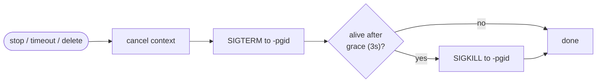

### 5.6 Egress and name resolution inside the jail

An `allow_net` workspace is in its **own** network namespace, connected to the
public internet only through **chained slirp4netns**:

```
workspace ns --slirp(UNIX socket)--> relay ns --slirp(UNIX socket)--> host
```

slirp4netns speaks to its parent over a UNIX socket and creates a tap interface
only inside the *child* namespace, so there are **zero host interfaces, routes or
veth pairs**. The engine-owned relay namespace carries a blackhole route for
every operator-private range, so a workspace reaches the public internet and a
public resolver but never the host LAN. (The earlier `clone_newnet: false`
host-network share is gone; see [DECISIONS.md](DECISIONS.md) #64.)

Name resolution is a *userspace* resolver problem: libc reads `/etc/resolv.conf`
and `/etc/hosts`. Both are bind-mounted read-only **conditional on `allow_net`**
(`{{ if .AllowNet }}` in the template), but the mounted `resolv.conf` names
**public** resolvers (`network.resolver`) — the host's own resolver is never
published — and the mounted `/etc/hosts` is a **generated** file holding only
generic localhost entries. The host's own `/etc/hosts` names the operator's
server FQDN and LAN address and is never mounted into a workspace. A workspace
without `allow_net` gets a private, empty namespace and no resolver. Render
tests pin both directions
(`TestRenderConfigMountsResolverWhenNetAllowed`,
`TestRenderConfigOmitsResolverWhenNetDenied`); the live egress and isolation are
measured by [`scripts/tunnel-check.sh`](../scripts/tunnel-check.sh); see
[VERIFICATION.md §8 and §9g](VERIFICATION.md).

### 5.7 Host-identity masking (the syscall view)

The mount namespace closes the **filesystem** view of the host (no host
`/proc`, no `/sys` — `/proc` is a curated per-workspace payload, see §5.2), but a
set of facts stays reachable by **syscall** and no mount hides
them: `uname(2)` (the platform kernel fingerprint), `sysconf(3)`/`sysinfo(2)`
(the host's real core count and total RAM), `sched_getaffinity(2)` (again the
core count), `getauxval(AT_HWCAP)` (a CPU fingerprint) and
`gnu_get_libc_version(3)`/`confstr(3)` (the base image's distro patch level).

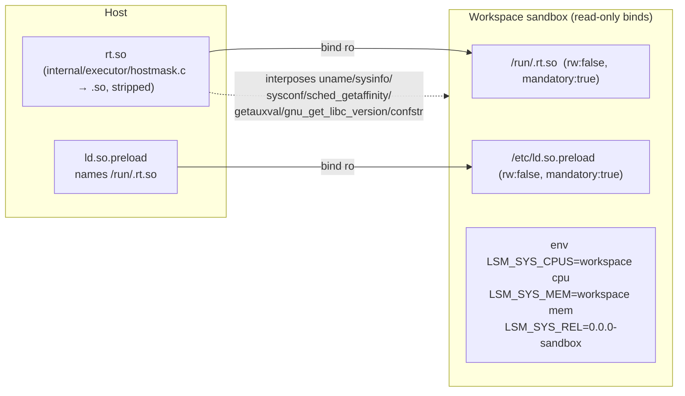

Every dynamically-linked exec is forced through the shim because the dynamic
loader reads `/etc/ld.so.preload` independently of the environment — so clearing
the environment (`env -i`) does not defeat it, which is the reason a plain
`LD_PRELOAD` **environment variable** was rejected (it is trivially cleared).
The shim reads the workspace's own `cpu_cores`/`memory_mb` from the injected
`LSM_SYS_*` environment (engine-neutral names, because a tenant reads its own
environment) and answers with those, with a floor of one cpu
and one MB. It is **on by default** (`identity.enabled`); when enabled but not
ready (`/readyz`: `identity_masking.enabled=true, ready=false`) the renderer
returns `ErrMaskUnavailable` and the run is refused, so a missing mask is a loud
`503`, never a silent leak.

The same shim also **hides the mechanism from the tenant** (ADR 79). It
interposes the filesystem entry points (`open`/`openat`/`stat`/`lstat`/`fstatat`/
`statx`/`access`/`eaccess`/`euidaccess`/`readlink`/`readdir`/`realpath`, with the
glibc-versioned exports their callers reference) and answers `ENOENT` — and drops
the directory entry — for `/etc/ld.so.preload`, its own in-jail path
`/run/.rt.so`, and the legacy `/sandboxd`, `/run/sandboxd`. So `ls`, `cat`,
`stat`, `test`, `find` and Python's `os.stat`/`os.listdir` all report those paths
missing. This is scoped to processes that **already have the shim mapped**: the
loader reads the preload list *before* any preload object is loaded, so a real
exec is still masked (`env -i uname -r` reports `0.0.0-sandbox`). The shim's own
strings carry none of the masked kernel values or variable names (they are XORed
and decoded at runtime); `readlink -f`/`realpath` never stat the leaf and echo
the literal input, so there is nothing to intercept there.

The shim also interposes **`dlsym`** itself. A handle-scoped lookup —
`ctypes.CDLL("libc.so.6").uname`, which resolves the symbol from libc's own
handle and normally skips a preload shim — is answered with the shim's own
function for any handle (measured; the full route list is in
[VERIFICATION.md §10](VERIFICATION.md)). This closed a bypass that had been
wrongly filed as inherent. The shim deliberately does **not** interpose `dlvsym`:
defining both on this glibc makes a versioned reference bind back to the
unversioned definition and the loader bootstrap recurses, so the residual
`dlvsym(handle, …)` route (not reachable from `ctypes`) is documented instead.

The **honest limits** are part of the design and kept in separate classes: a
statically-linked binary, a **musl** runtime (whose loader ignores
`/etc/ld.so.preload`), a raw `syscall(2)`, and a handle-scoped `dlvsym(3)` bypass
the masking interposition and see the real host values; a raw `syscall(2)` (but
not any libc call) also still reaches `/etc/ld.so.preload`, because the hiding
sits at the libc entry points, not under the kernel ABI. The raw-syscall result
is **asserted as a known outcome**, not left a surprise. Masking is
**defense-in-depth, not a security boundary**; the host filesystem view stays
closed by the mount namespace on every path (`/proc` is a curated per-workspace
payload, never the real procfs). The *visibility* of the mechanism is closed
(ADR 79); the narrower "no shim file at all" goal is open and measured
(ADR 77/80). See [DECISIONS.md](DECISIONS.md) #71–#80,
[VERIFICATION.md §10](VERIFICATION.md) for the measured numbers, and
[`scripts/identity-check.sh`](../scripts/identity-check.sh) for the assertions.

### 5.7b Per-workspace limits: the curated `/proc` and the real filesystem

The masking shim answers the **syscall** view with the workspace's own values;
the curated `/proc` (see §5.2) answers the **file** view with the SAME values,
so `free -h`, `vmstat` and a bare `df` report the workspace. The two are gated
together (masking on) so they can never disagree. The disk allowance is a real
per-workspace ext4 image mounted with `fuse2fs` (`internal/workspace/diskfs.go`,
`internal/service/disk.go`), host-side, so the filesystem itself is the boundary:
`df`/`stat -f`/`os.statvfs()` are correct with no syscall interception, and a
write past the allowance fails `ENOSPC` at the boundary. When FUSE is unavailable
a used-bytes watchdog stops an over-limit run (real but sampled). See
[DECISIONS.md](DECISIONS.md) #85/#86 and [VERIFICATION.md §14](VERIFICATION.md).

### 5.8 Provider identity: workspace profiles and the egress address

A workspace's toolchain is chosen by a **named profile**: an explicit,
reviewable **allowlist** of tools and the data/library trees they need. When
`identity.hide_provider_tools` is on (default), the sandbox replaces the host
`/usr` with a tree **materialized from the workspace's profile** — only the
commands the profile names, plus the engine base commands, the shared libraries,
the ELF loader and `/usr/lib/ssl` — and `/bin`, `/sbin`, `/lib`, `/lib64` are
bound to subtrees of the same tree so every conventional path is consistent.
The host's `/etc/ssl/certs` is replaced with a copy filtered of provider-named
certificates. The profile and cert binds are read-only `mandatory:true`: a tree
that cannot be mounted aborts the run rather than expose the host directory.

This is the opposite of the earlier denylist (which copied nearly all of
`/usr/bin` and `/usr/sbin` and removed only the engine/platform names): the
compiler chain, `apt`, `/usr/include`, `/usr/libexec` and the platform's
`/usr/local` tooling are absent because the profile never named them, not
because a filter stripped them. The engine's engine/platform name+content filter
still applies on top of a profile, and a profile entry naming the engine or
platform is refused (fail loud). A profile is data (`configs/profiles/*.yaml`,
embedded, overridable via `profiles.dir`): adding a language is adding a file.
See [DECISIONS.md](DECISIONS.md) #83.

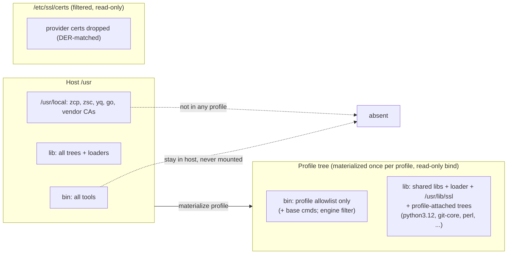

The **egress address** is a separate, structural fact: an `allow_net` workspace
exits through the platform's shared NAT, and that address is registered to the
provider (`AS43541 VSHosting`, RDAP name `ZEROPS-IO`), so a tenant who fetches
"what is my IP" learns the provider. No address outside the vendor's registered
ranges is obtainable on this platform (measured; see
[DECISIONS.md](DECISIONS.md) #76). An optional `network.egress_proxy` (default
**off**) injects the standard proxy environment variables; it changes the
outbound address and therefore the operator's abuse/reputation profile, so it is
the operator's explicit choice, never a default, and it is a soft mechanism (a
program that ignores the variables is unaffected).

---

## 6. File safety & disk quota

All file API paths are user-controlled, so they pass through two gates:

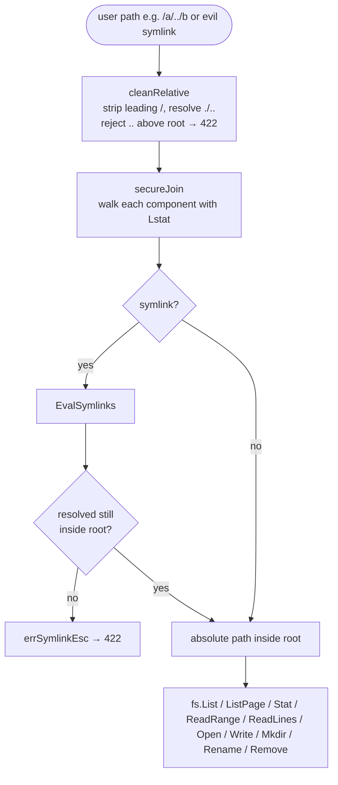

`Stat` uses `resolveFinal`, a variant that does not follow a symlink in the
final component so the link itself (type, target) can be reported, while still
rejecting a link whose target escapes the root.

Disk quota: two layers. (1) A real per-workspace ext4 filesystem image
(`{wsdir}/disk.img`) sized to `disk_mb` is mounted at the workspace root by the
orchestrator with `fuse2fs` (`internal/workspace/diskfs.go`), so the filesystem
itself refuses a write past the allowance (`ENOSPC`) and every reporting channel
(`df`, `stat -f`, `os.statvfs()`) is the filesystem's own answer; the API file
path and the sandbox see the same mounted filesystem (`WorkspaceFs` provisions
it before use). (2) `Fs` additionally tracks bytes and `reserve(delta)` rejects
writes, uploads and renames that would exceed `disk_mb` with
`507 insufficient_storage`; `Recheck()` recomputes usage with a bounded walk.
When the FUSE backend is unavailable a used-bytes watchdog (`disk_watchdog.go`)
stops an over-limit run — real but sampled (see [DECISIONS.md](DECISIONS.md)
#85).

---

## 7. Data model & on-disk layout

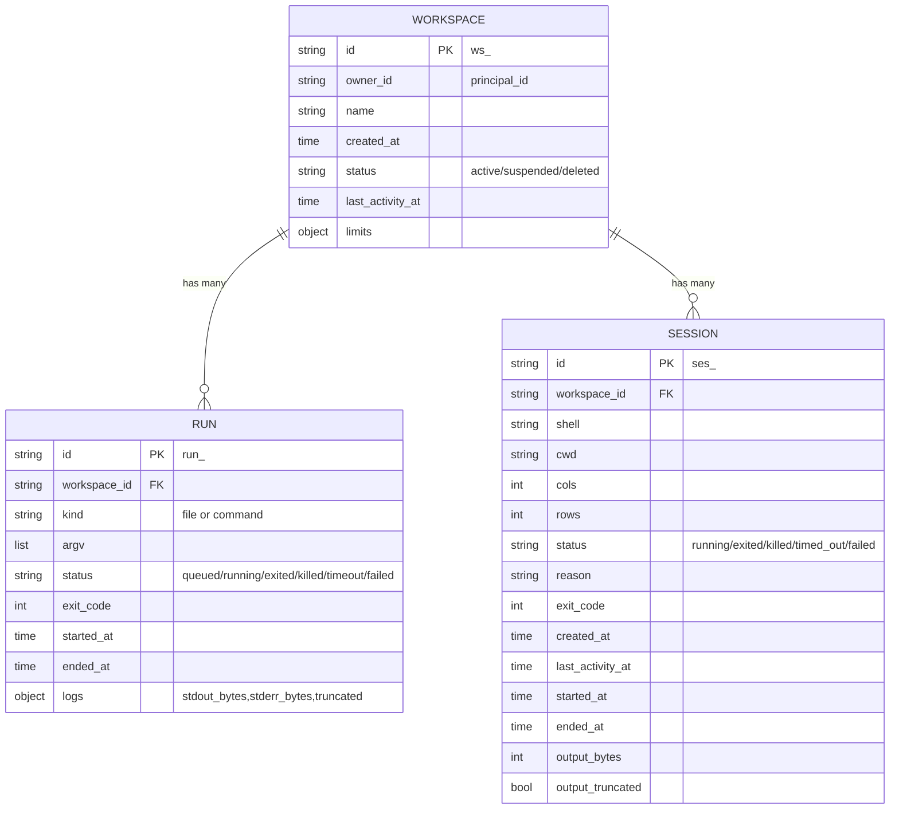

```
{data_dir}/
├── tmp/                                  transient nsjail configs + per-run /tmp
└── workspaces/
    └── {ws_id}/
        ├── meta.json                     workspace metadata (atomic write)
        ├── files/                        the workspace root (bind-mounted at /workspace)
        │   └── ...                        user files
        ├── packages/                     PRIVATE package tier (bind-mounted
        │   └── ...                        writable at /opt/python/private)
        ├── runs/
        │   └── {run_id}/
        │       ├── meta.json             run metadata (atomic on every transition)
        │       ├── stdout.log            capped run stdout
        │       └── stderr.log            capped run stderr
        └── sessions/
            └── {ses_id}/
                ├── meta.json             session metadata (atomic on every transition)
                └── output.log            capped PTY output stream
```

Metadata writes are **atomic**: write to a temp file in the same directory,
`fsync`, then `rename` over the target (`writeJSONAtomic`). Runs are retained per
workspace (last 100; pruned to 99 before each new run) to bound disk growth
without a background GC.

---

## 8. API surface at a glance

```mermaid
flowchart LR
    subgraph unversioned["unversioned probes"]
        H["GET /healthz"]
        R["GET /readyz"]
        M["GET /metrics"]
    end
    subgraph v1["/v1 (Bearer auth)"]
        META["GET /meta"]
        WC["POST/GET /workspaces"]
        W["GET/PATCH/DELETE /workspaces/{id}"]
        LIFECYCLE["POST .../{suspend,resume,stop}"]
        USAGE["GET /workspaces/{id}/usage"]
        PKG["GET/DELETE /workspaces/{id}/packages\nPOST .../packages/install"]
        F["GET/DELETE /files · /files/stat\nGET/PUT /files/content · /files/download\nPOST /files/{mkdir,rename,upload}\nPOST/GET /files/archive · POST /files/extract"]
        EX["POST /exec (sync, ≤60s)"]
        RN["POST/GET/DELETE /runs · /runs/{id}\nPOST /runs/{id}/stop\nDELETE /runs/{id}\nGET /runs/{id}/logs"]
        SS["POST/GET /sessions · /sessions/{id}\nPOST .../input|signal|resize\nGET .../output\nDELETE /sessions/{id}"]
    end
```

| Method & path | Purpose | Success | Common errors |
|---------------|---------|---------|---------------|
| `GET /healthz` | liveness | 200 | — |
| `GET /readyz` | data dir + nsjail present | 200 / 503 | 503 `{nsjail:false}` |
| `GET /metrics` | Prometheus text | 200 | — |
| `GET /v1/meta` | version, runtimes, default limits | 200 | 401 |
| `POST /v1/workspaces` | create | 201 | 400, 413, 422 |
| `GET /v1/workspaces` | list owned | 200 | 401 |
| `GET /v1/workspaces/{id}` | get | 200 | 403, 404 |
| `PATCH /v1/workspaces/{id}` | update name/limits at runtime | 200 | 400, 422 |
| `DELETE /v1/workspaces/{id}` | stop runs + rm tree | 204 | 403, 404 |
| `POST .../{id}/suspend` | refuse new work + stop runs | 200 | 404 |
| `POST .../{id}/resume` | accept work again | 200 | 404 |
| `POST .../{id}/stop` | stop all runs, stay active | 200 | 404 |
| `POST .../{id}/subscription/extend` | renew a term (additive live / from-now+unlock when locked) | 200 | 404, 422 `subscription_invalid`/`max_duration_exceeded`/`subscription_would_shorten` |
| `GET .../{id}/usage` | disk bytes, run counters, limits | 200 | 404 |
| `GET .../{id}/packages` | private-tier packages + shared status | 200 | 403, 404 |
| `POST .../{id}/packages/install` | pip install into private tier | 200 | 422 bad req, 409 suspended, 503 |
| `DELETE .../{id}/packages` | remove one (`?name=`) / all (`?all=true`) | 204 / 200 | 400, 404 |
| `GET .../files?path=` | list dir (bounded page, metadata) | 200 | 422 unsafe, 422 `not_directory` (a file) |
| `GET .../files/stat?path=` | metadata for one path | 200 | 404, 422 |
| `GET .../files/content?path=` | read whole / byte range / line range (raw or `?meta=true`) | 200 | 404, 413, 422, 422 `not_directory` |
| `GET .../files/download?path=` | stream the entire file (exempt from `file_read_mb`) | 200 | 404, 422, 422 `not_directory` |
| `PUT .../files/content?path=` | write text/base64 (`content` required) | 204 | 400, 507 quota, 422 `not_directory` |
| `DELETE .../files?path=` | delete | 204 | 404, 422 |
| `POST .../files/mkdir` | mkdir -p | 201 | 400, 422 |
| `POST .../files/rename` | rename | 204 | 404, 422 |
| `POST .../files/upload` | multipart upload | 201 | 413, 507 |
| `POST .../files/archive` | upload-and-extract an archive | 200 | 409 collision, 413 cap, 415 format, 422 unsafe/encrypted/multivolume |
| `POST .../files/extract` | extract an in-workspace archive | 200 | 404, 409, 413, 415, 422 |
| `GET .../files/archive?path=` | export a directory as a zip | 200 | 404, 422 `not_directory` |
| `POST .../exec` | sync run | 200 | 422 bad cmd, 409 suspended, 503 no nsjail |
| `POST .../runs` | async run | 202 | 400, 409 suspended |
| `GET .../runs` / `.../runs/{id}` | list (filter/page) / get | 200 | 400, 404 |
| `DELETE .../runs` / `.../runs/{id}` | purge finished runs / one run | 200 / 204 | 409 running |
| `POST .../runs/{id}/stop` | kill process group | 202 | 404 |
| `GET .../runs/{id}/logs` | poll logs | 200 | 404 |
| `POST .../sessions` | start interactive PTY session | 201 | 409 suspended/sessions, 422 |
| `GET .../sessions` / `.../sessions/{id}` | list (filter/page) / get | 200 | 400, 404 |
| `POST .../sessions/{id}/input` | write bytes to the PTY | 204 | 409 ended, 413 |
| `POST .../sessions/{id}/signal` | signal foreground process group | 204 | 409 ended, 422 |
| `POST .../sessions/{id}/resize` | `TIOCSWINSZ` | 204 | 409 ended, 422 |
| `GET .../sessions/{id}/output` | poll PTY output by offset | 200 | 409 ended |
| `DELETE .../sessions/{id}` | graceful close (idempotent) | 200 | 404 |
| `GET .../processes` | every live process in the workspace (inventory) | 200 | 403, 404 |
| `POST .../processes/{processID}/stop` | stop one process tree (cgroup-scoped) | 200 | 403, 404 |
| `GET .../ports` | ports the workspace is listening on + their owner (on-demand) | 200 | 403, 404, 404 `ports_disabled` |

All errors share one envelope:

```json
{"error":{"code":"unprocessable","message":"unsafe path: escapes workspace root"}}
```

---

## 9. Configuration reference

`configs/config.example.yaml` (loaded over built-in defaults by koanf):

```yaml
server:   { addr: "127.0.0.1:8080" }
storage:  { data_dir: "./data" }
sandbox:
  nsjail_path: "nsjail"      # missing → /readyz 503, runs → 503
  user: "sandbox"            # host user inside the jail
  group: "sandbox"
  kill_grace_sec: 3          # SIGTERM → SIGKILL grace
limits:                      # default per-workspace limits (overridable)
  cpu_cores: 1
  memory_mb: 512
  disk_mb: 1024
  max_wall_time_sec: 300
  max_runs: 3
max_limits:                  # hard server maxima (create + PATCH enforced)
  cpu_cores: 8
  memory_mb: 8192
  disk_mb: 51200
  max_wall_time_sec: 3600
  max_runs: 64
caps:                        # hard ceilings, never overridable per request
  exec_stdout_kb: 256
  exec_stderr_kb: 256
  run_log_mb: 10
  json_body_mb: 1
  upload_mb: 50
  file_read_mb: 5
  file_write_mb: 10
  file_list_max: 1000
packages:                    # two-tier Python packages
  shared_dir: "/opt/sandboxd/packages"       # RO bind; empty disables
  shared_enabled: true
  shared_requirements: ""    # optional, informational only
  install_timeout_sec: 120
  install_output_kb: 256
sessions:                    # interactive terminal sessions (all defaulted)
  max_per_workspace: 4       # 409 too_many_sessions past this
  idle_timeout_sec: 900      # no activity → timed_out/idle_timeout
  lifetime_sec: 3600         # absolute ceiling → timed_out/lifetime
  output_kb: 1024            # capped PTY output log
  max_input_kb: 64           # per-request input cap
  shell: "/bin/sh"           # default shell in the image
  kill_grace_sec: 3          # SIGHUP → SIGKILL grace
  start_probe_ms: 250        # startup reap window → honest failed vs running
subscription:                # workspace terms (engine clock; no billing)
  enabled: true              # false = the reaper does not run (no lock/delete)
  default_duration: ""       # empty = a workspace that does not ask gets NO expiry
  max_duration: "365d"       # server ceiling, measured from now
  grace_period: "168h"       # 7 days locked before deletion
  reap_interval: "60s"       # reaper tick
archives:                    # native archive handling (in-engine; all defaulted)
  enabled: true              # false refuses every archive route (422)
  max_entries: 20000         # 413 archive_too_many_entries past this
  max_total_mb: 2048         # streaming total budget → 413 archive_too_large
  max_file_mb: 512           # per-entry cap → 413 archive_too_large
  max_ratio: 200             # compression-ratio bomb guard → 413 archive_ratio_exceeded
  upload_mb: 50              # archive upload cap (separate from caps.upload_mb)
  overwrite: false           # default collision policy → 409 archive_entry_exists
  skip_junk: true            # skip __MACOSX/, .DS_Store, ._*, Thumbs.db, desktop.ini
  formats: ["zip", "rar"]    # content-detected allowlist (RAR is read-only)
metrics:                     # per-workspace RAM+disk stream (all defaulted)
  enabled: true              # false refuses every metrics route (404)
  interval: "3s"             # stream cadence (clamped to [min,max])
  min_interval: "1s"         # enforced floor; a lower request is 422
  max_interval: "300s"       # enforced ceiling
  include_cpu: false         # opt-in cpu.stat + pids.current (the costly files)
  idle_reconcile_interval: "15s" # inventory refresh (live cgroups are per-tick)
  max_subscribers: 1024      # concurrent streams cap
ports:                       # native port/service discovery (ON by default)
  enabled: true              # false = the route reads 404 ports_disabled
  max_pids: 64               # bounded-scan cap: processes examined
  max_fds_per_pid: 512       # bounded-scan cap: fds examined per process
  include_unix: true         # report unix sockets (in the SEPARATE unix section)
keys:                        # service bearer keys → principal_id (1:N allowed);
                             # held by the frontend, never by end users
  - { key: "dev-key-please-rotate", principal_id: "user_dev" }
```

`max_runs` maps to the cgroup `pids.max` as `max_runs * 64`.

---

## 10. Deployment & host requirements

nsjail needs to create namespaces, mount cgroup v2, and (when root) chown the
workspace. It therefore requires one of:

1. running sandboxd as **root**,
2. a **setuid** nsjail binary, or
3. a **privileged container**.

In addition, cgroup v2 ceilings (memory, pids, cpu) require the container to run
with **`--cgroupns=host`** so nsjail can write the host cgroup subtree. Without
it nsjail aborts before `execve`; the service reports `cgroups:false` on
`/readyz` and returns `503 unavailable` (naming the nsjail diagnostic) for every
execution.

```mermaid
flowchart TD
    Q([Where will you run sandboxd?])
    Q --> A["Bare host, root\n✅ works (add --cgroupns=host if containerised)"]
    Q --> B["Bare host, unprivileged\n⚠️ fails at uid_map if\napparmor_restrict_unprivileged_userns=1\nor no CAP_SYS_ADMIN"]
    Q --> C["docker --privileged --cgroupns=host\n✅ works (used for E2E)"]
    Q --> D["docker --privileged (no --cgroupns=host)\n❌ nsjail aborts before execve\ncgroup ceilings absent"]
```

Observed on Ubuntu Noble (kernel 7.0, Go 1.26.8): with
`kernel.apparmor_restrict_unprivileged_userns = 1` and `CapEff=0`, nsjail cannot
write `uid_map` on the bare host. The verified E2E setup runs the server in a
privileged container:

```sh
docker run --rm --privileged --cgroupns=host -p 8080:8080 \
  -v "$PWD":/src -w /src ubuntu:24.04 \
  ./bin/sandboxd --config config.yaml
```

This is a **host restriction, not a sandboxd bug**. `/readyz` reports `nsjail`
and `cgroups` separately so an operator can tell which requirement is missing.

---

## 11. Verification & testing

Testing is layered so that most of the suite needs neither nsjail nor root:

```mermaid
flowchart LR
    U["Unit tests\n(go test ./...)\nhandlers via httptest\nFakeRunner\npath-safety, storage, config"] --> R["Race suite\n(go test -race ./...)"]
    R --> I["Integration\n(//go:build integration)\nreal nsjail in privileged container"]
    I --> A["Privileged suites\nscripts/acceptance.sh\nscripts/session-nsjail-check.sh\nfull HTTP lifecycle + isolation\nreal-nsjail terminal sessions"]
```

Both `scripts/acceptance.sh` and `scripts/session-nsjail-check.sh` are the
**privileged suites**: `acceptance.sh` runs the full HTTP lifecycle + isolation
transcript (normally inside the `--privileged --cgroupns=host` image via
`make acceptance`), and `session-nsjail-check.sh` runs the terminal-session
acceptance against real nsjail on the host (via `make session-check`; no
container, but root + a real nsjail).

Evidence lives in [`docs/VERIFICATION.md`](VERIFICATION.md). Highlights from the
real-nsjail acceptance transcript:

| Check | Observed | Meaning |
|-------|----------|---------|
| traversal read/write/delete | 422 ×3 | path-safety works |
| symlink escape | 422 | symlink defense works |
| missing token / cross-owner | 401 / 403 | auth + ownership work |
| oversized body | 413 | caps work |
| network egress | `NET_BLOCKED: OSError` | net namespace isolates |
| `/etc/shadow` | `FileNotFoundError` | not mounted |
| `mount(2)`/`ptrace` | exit **159** (SIGSYS) | seccomp kills it |
| memory ceiling (workspace parent `memory.max`) | 4 GiB touch killed (exit 137, run status `oom`) | per-workspace physical ceiling enforced as the SUM across runs (ADR 94) |
| fork bomb | `FORKED 191` then `BlockingIOError` | cgroup pids limit |
| stop long run | status `killed`, no orphan | process-group kill |
| launch failure (no `--cgroupns=host`) | 503 + nsjail diagnostic | failure is explicit |

`scripts/acceptance.sh` deliberately **refuses to run against the test stub**:
set `NSJAIL=/usr/local/bin/nsjail` and it will verify the binary is real.

---

## 12. Known limitations

Deferred to v0.1 (documented, not bugs):

- **SSE log streaming** — v0.0.20 polls logs with `offset`/`limit`.
- **Multi-node storage / sharding** — storage is a local filesystem.
- **Dynamic/DB authentication** — keys are static in config (bearer auth itself
  is exercised by `TestAuth*`).
- **Per-UID-per-workspace isolation** — v0.0.20 uses a shared `sandbox` UID/GID
  with per-run user namespaces + cgroups.
- **Kernel-enforced per-run disk quota** — disk is accounted on the file API
  path and rechecked with `du`; the sandbox process is bounded by `rlimit_fsize`
  per file (now correctly in MB), not a total per-tree quota.
- **Process ceiling** — `RLIMIT_NPROC` does not bind for the root-run sandbox;
  the ceiling is provided by `pids.max` on the workspace's parent cgroup, hence
  cgroup v2 (`--cgroupns=host`) is mandatory.
- **Bare-host unprivileged operation** — blocked by AppArmor unprivileged-userns
  restrictions on some kernels; run as root / setuid / privileged container.

---

## 13. Decision index

The 58 frozen product decisions live in [`docs/DECISIONS.md`](DECISIONS.md),
including the isolation model, network default-off, retention (100 runs),
exec-vs-runs split, disk-quota strategy, caps, path safety, process kill, error
envelope, ULID IDs, health-probe semantics, the cgroup/rlimit/env/lifecycle
corrections, run recovery, the workspace control plane (runtime-mutable limits,
suspend vs stop, run filter/purge, usage accounting), the two-tier package model,
the conditional resolver mounts, terminal sessions (the PTY helper vs its
alternatives, stdin-pipe vs `--pass_fd`, signal-vs-stop, idle/lifetime values,
restart/cleanup, output reuse and injection-proofing), the engine/frontend
product boundary (#54), first-class file browsing/viewing (#55–58), the
per-workspace disk boundary and curated `/proc` (ADR 85/86), and workspace
subscriptions: the engine clock and absolute instants (ADR 87), the duration
grammar with `mo`/`y` approximations (ADR 88), `locked` vs `suspended` and the
allow/refuse split (ADR 89), the extension semantics (ADR 90), and the reaper
(pure decision, injected clock, idempotent, backwards-clock rule; ADR 91), and
native archives: in-engine extraction (no host tool), the `rardecode/v2`
dependency and read-only RAR, the validate-before-write rule and streaming
budget, the link/mode policy, the collision policy and `dry_run` (ADR 92).

---

## 14. Glossary

| Term | Meaning |
|------|---------|
| **workspace** | Named, owned container of files + runs; `ws_<ULID>` |
| **run** | One async execution; `run_<ULID>` |
| **exec** | One synchronous execution (≤60 s), output returned inline |
| **session** | One interactive terminal with a real PTY; `ses_<ULID>` |
| **PTY relay helper** | Stdlib-only Python script that allocates the PTY and relays the control protocol inside the sandbox |
| **principal** | Identity behind a service bearer key; ownership is per-principal. The key is held by the frontend, not by an end user |
| **nsjail** | Linux sandbox tool built on namespaces, cgroups, seccomp, rlimits |
| **cgroup v2** | Unified Linux resource-control hierarchy |
| **seccomp** | Syscall filtering; sandboxd KILLs a dangerous denylist |
| **uidmap/gidmap** | Translation of in-namespace IDs to outside IDs |
| **ULID** | Lexicographically sortable, collision-resistant ID |
| **cap** | Hard output/body ceiling that requests cannot raise |
